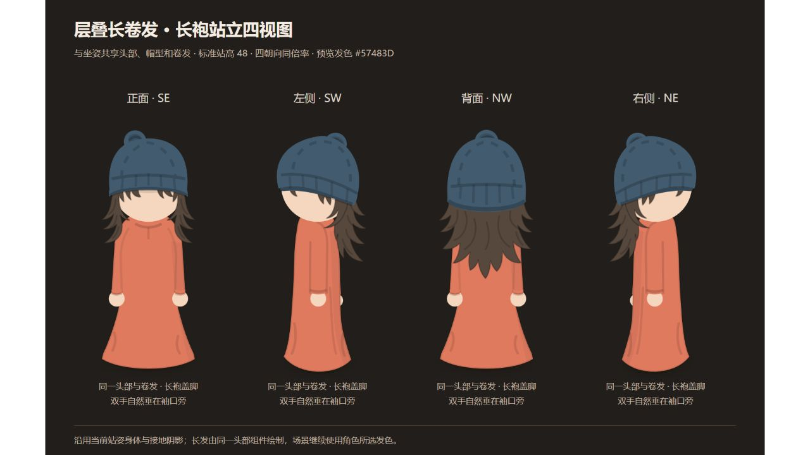
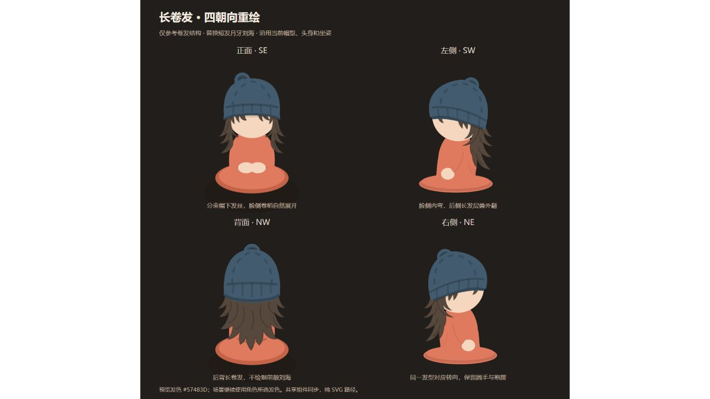

# 层叠长卷发重绘 v13

日期：2026-10-14（Asia/Shanghai）。范围：常规人物的 SE / SW / NW / NE 长卷发，沿用当前帽型、头身与坐站身体。

## 当前：坐姿与站姿四视图齐备

用户要求补齐长卷发站姿资源。新增 `character-curly-standing-4views.svg` 及 `character-curly-standing-front/left/back/right.svg`，直接复用当前 StandingCharacter 与已认可的 CurlyHair，头部大小和发长与坐姿一致，标准站高约 48，长袍盖脚。坐姿文件及人物造型保留，生成脚本一次维护两套姿态。

网页入口：左侧“人物 4 视图 SVG” → “层叠长卷发” → “坐姿四视图” / “站姿四视图”。每套姿态均可预览、打开完整网页、下载或复制总表和四个独立朝向。站姿比较/地面/材质选择仍对应已有短发资源，切换到卷发时直接使用卷发站姿总表，不误用短发附加页面。

类型检查、生产构建及 7 项人物浏览器检查通过，覆盖桌面与 390px 手机上的卷发坐站切换、完整页面、总表复制和下载、全部单图下载、切回短发及 25 张 SVG 的资源、取景与朝向。IAB 核对站姿总表的肩背长发、帽檐、圆手与袍摆。

## 最初重绘与入口记录

用户提供四视图参考，明确只参考卷发绘制，并去掉原利落短发的黑色月牙刘海。旧实现的正面卷发仍进入默认短发刘海分支，侧面则不区分发型绘制共用月牙；外延卷发只有几团短圆弧，与参考中的层叠长发不同。

新增 CurlyHair：正面两侧是弯曲、逐层外翻的发束，帽下仅露出分开的短发梢；侧面区分向内弯的脸侧发束与向外翻的长后发；背面由完整长发轮廓覆盖肩背，末端分束，不绘制前额刘海。内部少量弧线表达发束方向，不添加高光、滤镜或动画。发根先绘制，再由现有帽冠和帽檐遮挡，避免头发覆盖针织帽檐。

保留 wavy_curly / curly 的既有发型标识，装扮入口名称改为“层叠长卷发”。角色所选发色继续通过 hairColor 传入，新四视图以 #57483D 棕色展示卷发层次。参考图的身体、地面、阴影与帽子均未复制；预览直接使用当前 SeatedReferenceCharacter 和共享 CharacterHead，场景、状态面板和站姿同步使用新发型。

生成命令：`node --import tsx scripts/generate-curly-character.tsx`。坐姿资源为 `public/character-curly-4views.svg` 与 `character-curly-front/left/back/right.svg`；站姿使用 `character-curly-standing` 前缀。两套均为纯矢量四朝向。

用户认可卷发视觉后补齐网页入口：左侧“人物 4 视图 SVG”打开“人物四视图 · 查看与导出”，可选择“经典短发”或“层叠长卷发”。卷发总表提供窗口预览、“打开完整四视图”、下载及复制，四个单独朝向也可预览/下载/复制。短发坐姿、站姿、比较、地面和材质内容继续可用。切换发型清除复制反馈；手机操作按钮换行，预览高度适配窗口。首批入口只有卷发坐姿，随后按用户要求补齐站姿，当前两种发型均可切换坐站。资产造型保留。

入口补充验证：类型检查、生产构建及人物/原交付流程共 9 项浏览器检查通过，覆盖桌面与 390px 手机、完整四视图新标签页、总表复制/下载与四个独立下载，以及 20 张 SVG 的资源和取景；收紧预览高度后重新验证桌面与手机流程。IAB 核对窗口与入口，截图如下。

本轮先处理这一款长卷发的常规四朝向。披肩长发、及肩直发和睡姿尚未按此参考精修；不视为第 0 项的全部发型与姿态已验收。第三阶段未启动。

类型检查、生产构建和 7 项人物浏览器检查通过：装扮入口切换后，茶桌双席和站姿复用新卷发；无原短发月牙路径，帽下发束先于帽子绘制；16 张 SVG 的资源、取景和朝向检查通过，蒲团共面及桌面/手机导出检查保留。原短发的 13 张坐站 SVG 重新生成后 SHA-256 全部一致。IAB 核对四朝向，生产测试截图核对实际双席卷发场景。未新增依赖、动画或每帧计算，本轮未进行性能采样。

