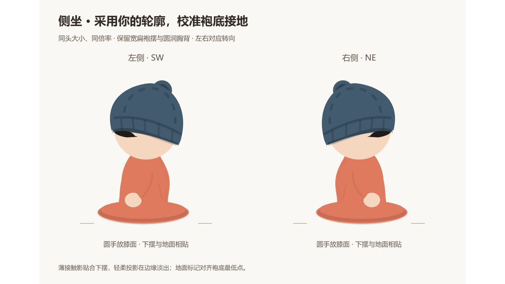

# 人物比例稿：头肩轮廓修正与四视图

日期：2026-10-14（Asia/Shanghai）。状态：**短发独立稿沿用 v11，蒲团装配沿用 v12；v13 新增长卷发常规四朝向重绘，详见 [卷发修订记录](CHARACTER_CURLY_HAIR_REVISION.md)。**

## 当前场景 v12：蒲团与袍摆共面

用户指出实际品茶人物的袍摆、阴影和坐垫像位于不同平面。v11 仅校准了独立人物的地面锚点，实际场景仍使用旧缩放支点 y=3.5：新袍摆中心变成 y≈4.78，并有横向偏移；袍摆扁率约 0.244，旧蒲团顶面为 0.375。旧蒲团侧面上沿的贝塞尔弧也没有贴合顶面椭圆，地面投影仍是偏低的大椭圆。

本轮保留 v11 左右侧坐身体、头部和全部导出 SVG。新增 TeaCushion，以认可袍摆的扁率构建顶面：半宽 12、半高约 2.932，中心仍 (0,3.5)。人物按袍摆真实中心 (-0.6,4.7) 对齐坐垫中心，保持 48/45 等比缩放；西席整体镜像后依然居中，持杯方向保留。南席场景中的背坐底部椭圆同步匹配此平面，上身与头部保留；独立正背坐姿稿不变。

蒲团前侧采用与顶面同半径的上下两条椭圆弧，垂直厚度 2；坐垫底部增加 0.16 的窄接触影，淡出地面投影贴着底部展开，删除旧偏低的模糊大椭圆。袍底窄接触影落在蒲团顶面，蒲团接触影落在地毯；空席和有人坐下复用同一家具几何，布局锚点与校准高亮保留。

类型检查、生产构建和 6 项人物浏览器检查通过。新增检查直接测量实际袍摆中心、与顶面相同的扁率、袍摆在顶面内、蒲团厚度和地面影衔接，覆盖默认单席/空席及双席对坐；原同头大小、场景尺寸、1200 / 390px 导出及 15 张 SVG 检查保留。IAB 放大核对单席与空蒲团，生产测试截图核对双席。此轮只修正静态装配与家具几何，未进行性能采样；其它发型兼容、睡姿、八向素材及第三阶段仍待后续处理。


## v11 独立资产基准：采用用户手绘轮廓与接地校准

用户手绘左侧坐姿是本轮身体轮廓的直接来源：保留胸腹、圆背、近袖、圆手和三层宽扁袍底，不再用固定的侧面宽度比例约束自然铺开的衣料。右侧复用同一体型并镜像转向，帽檐、原月牙刘海、近袖、圆手及后背衣片均对应换侧。共享头部大小及正背坐姿、全部站姿资产保留。

袍底外椭圆为中心 (-0.6,4.7)、半径 (10.044,2.454)，真实最低点 y=7.154。参考图以此重新归零地面，避免仍用旧 y=8 锚点产生空隙；侧坐名义含帽高度约 34.3，正背坐姿仍约 35.2，头圆直径均约 14.93 场景单位。坐站比较图按各自地面锚点重新对齐头心，不拉伸用户轮廓。

替换原下方孤立椭圆投影：下摆下沿增加 0.22 authoring 单位的贴边接触影，两端淡出；轻柔径向渐变紧贴袍底轮廓，无模糊滤镜。实际蒲团人物保留家具坐垫接触位置，使用同一袍底与窄接触影，复用坐垫原有地面投影。参考四视图、左右单图、坐站比较及场景品茶人物同步，新增浅色背景 `character-seated-side-contact-v11.svg` 供检查两侧及接地。

类型检查、生产构建及 5 项人物浏览器检查通过，覆盖双席持杯朝向、场景坐站尺寸、1200 / 390px 导出与 15 张 SVG 的取景、实例 ID 和内部资源；额外验证两个侧坐的袍底最低点与地面锚点一致、圆手朝向相反。IAB 核对浅色左右接地图，生产测试截图核对双席场景。正背坐姿及全部站姿 SVG 的 SHA-256 与本轮修改前一致。未新增依赖、动画或每帧计算；本轮未进行性能采样。其它发型兼容检查、睡姿和八向素材仍待后续处理，第三阶段未启动。




## v10 历史记录：侧坐松弛感

用户认可原稿的松弛可爱，但原稿身体侧身不足；指出 v9 的细直上身、较强袖线和厚圆袍底削弱了氛围。按已确认的分析方案，保留头部大小、头肩连接、坐高和袍底横向跨度，只向前补圆胸腹中下段并顺接膝部，后背继续收拢以表达侧身。

下层袍底半高由 3.9 减至 3.3，上层半高由 3.6 减至 3.0；同步移动椭圆中心，底边仍分别为 y=8 / 7.1。近侧圆手保持 v9 尺寸，从 (-3.85,1.3) 回收到 (-2.8,2)，更靠近膝面；茶杯随手平移 (1.05,0.7)。近袖长双线减为一段浅弧，袖口顺成连续弧线，背侧缝缩短减淡，衣片阴影减轻。左右继续共享身体并镜像。

坐姿四视图、左右单图、同头大小对照、导出说明和实际品茶人物同步。新增 `character-seated-side-relaxation-v10.svg` 保存 v9 / v10 的同倍率前后对照，头心与落地锚点对齐；仅作为本轮评审资产，不新增导出窗口选项。正背面坐姿及全部站姿/地面/材质 SVG 的 SHA-256 与修改前一致。

类型检查、生产构建及 5 项人物浏览器检查通过，覆盖双席持杯朝向、坐站尺寸、1200 / 390px 导出，以及 14 张 SVG 的取景、资源引用、同头大小。IAB 核对对照图；生产测试截图核对双席场景。未新增依赖、滤镜、动画或每帧计算，未进行新的性能采样；其它发型适配与第三阶段尚未启动。


## v9 历史记录：圆手风格统一

用户将正面坐姿的松弛感、圆手及袍子流畅度指定为基准，希望其余姿态具有类似哆啦A梦的圆手形态。正面坐姿独立 SVG 的 SHA-256 与修改前相同，保持其原造型。

新增 RoundCharacterHand：简洁圆形或轻微椭圆，不绘制指缝、指节或尖拇指；姿态衔接由袖口遮挡完成。侧坐用饱满椭圆替换尖腕手，站姿四朝向用圆掌替换细长手，并让袖口覆盖手掌上缘。远侧手继续由袍身遮挡；背面盘坐保持膝前手部的原遮挡。

实际场景同步：品茶复用侧坐圆手，观测站复用站姿圆手；桌前手掌收圆并去掉指缝，保留键盘接触位置和肤色；持书坐姿增加位于袖端的圆手，由书本覆盖上缘。头部、身体主体轮廓、站坐高度及家具锚点保持当前设定。

类型检查、生产构建和 9 项人物/椅子浏览器检查通过，覆盖双席朝向、坐站尺寸、1200 / 390px 导出与椅子检视、装扮同步，以及 13 张 SVG 的资源和取景。IAB 核对坐站对照、桌前关系和持书场景，截图保存。未新增依赖、滤镜、动画或每帧计算，未进行新的性能采样。


## v8 历史记录：袍底与手腕衔接

用户指出 v7 侧面袍底不如正背面自然，手与胳膊衔接不顺。本次侧面下摆改为正背面同类的双层椭圆圆弧，删除不规则前膝覆盖片；背侧衣片阴影与侧缝止于袍底上方，保持连续底边。头肩和袍底横向跨度 14.8 authoring 单位保留。

近侧手改为带腕部的连续皮肤形状，与斜袖口共享边界并重叠绘制；袖口沿前臂方向连接手腕，删除原先仅与袖口尖端相切的独立椭圆手和额外远侧手。远袖继续被身体遮挡。品茶人物通过共享组件同步修正，杯子仍位于前方手部。

类型检查、生产构建及 5 项人物浏览器检查通过，覆盖双席朝向、坐站尺寸、1200 / 390px 导出与 13 张 SVG 的资源和取景。IAB 核对坐站对照。正背面坐姿及左右站姿文件 SHA-256 与修改前一致；未新增依赖、动画或滤镜。


## v7 历史记录：侧身盘坐轮廓

保留现有坐姿头部、刘海、帽型和尺寸。侧面袍底横向跨度由 18 收至 14.8 authoring 单位，为正背面跨度 20 的 74%；前膝和后背衣片采用不同轮廓，保持圆润胸腹与连续头肩衔接。近侧袖前屈，手轻放在前方膝上，远侧袖和手先绘制并被身体遮挡；淡侧缝和后背衣片阴影辅助表达方向，左右采用镜像身体。

新增 SeatedSideBody 供参考图和实际茶桌侧身人物复用。场景保留蒲团与落座锚点，并在前方手部绘制茶杯；西席整体镜像人物和杯子，两个侧身均面向茶桌。坐姿高度仍约 35，头圆直径仍约 14.93 场景单位。正面、背面坐姿及所有站姿独立/总表/地面/材质 SVG 的 SHA-256 与修改前一致。

四视图总表、坐姿左右单图、坐站同头大小对照及导出说明已同步。类型检查、生产构建及 5 项人物浏览器检查通过，覆盖双席朝向、实际坐站尺寸、1200 / 390px 导出操作，以及 13 张 SVG 的取景、资源引用和同头大小。IAB 核对对照图，生产测试截图核对双席场景；无新增依赖、动画或滤镜，未进行新的性能采样。此轮仍为四朝向手绘轮廓调整，未建立八向连续转身模型。


## v6 历史记录：站坐场景尺寸

标准站高约 48 场景单位，从地面锚点到毛线帽顶部计算，排除阴影和名牌。保留 v5 的站姿路径，统一乘以 48/45；名义头圆直径约 14.93。蒲团参考坐姿同倍率绘制，并把原 y=8 的地面锚点归零，总高约 35.2。

主屋品茶和沙发人物围绕原坐垫接触位置放大，维持相同头部大小，当前家具下的地面到帽顶高度分别约 35 / 43。桌椅人物头部使用同一半径，地面到帽顶约 44；单独降低上身肩线，保留坐垫、脚和键盘手部位置，耳机随头部调整。导出窗口、独立 SVG 和坐站对照同步。

观测站改用当前标准站姿，补偿建筑 0.8 倍缩放，实际世界站高仍约 48；落脚点位于操作地垫内部，控制台和前栏杆继续在人物前方遮挡。床内睡姿及其它人物状态未在本次校准。

坐姿两张侧图的袍底宽度约为正面的 90%，身体保留较大的胸前衣片，头与身体的侧身线索强弱不同，因此更像斜侧身。SVG 当前由朝向标签选择手绘路径，没有连续转身角度或八向投影；不能直接认定它们是已校准的八向素材。后续可保留头肩连接及刘海，单独收侧面体积、调整近远手臂遮挡及衣片前后关系。本次仅调整大小，不修改该侧身轮廓。

类型检查、生产构建、8 项人物导出及桌椅检视检查通过，覆盖 1200 / 390px、资源和取景、下载复制、家具接触锚点、实际头部倍率、站高及地垫内落脚位置。IAB 核对坐站对照和主屋；生产测试截图核对观测站。新增静态路径复用，无新依赖或每帧尺寸运算，未进行新的性能采样；第三阶段未启动。


## v5 历史记录：侧身轻补厚与接触阴影

按用户确认的微调范围，仅调整侧身胸背到腰腹的前后曲线，保持头肩连接、原刘海、袖子遮挡及袍摆横向跨度 13.2。局部 y=−18 / −12 两个水平截面的轮廓宽度分别增加约 6.6% / 6.8%，没有整体缩放头部或扩大下摆。

原柔和椭圆地面投影继续保留；在四朝向袍摆下方增加贴合原底边的窄接触阴影，渐变淡出两端，仍为静态 SVG 路径，不使用模糊滤镜。正面、背面的身体分组 XML 校验值与 v4 相同；完整文件因阴影资源和图形新增而更新。

新增 `character-shorthair-standing-surfaces.svg`：复用主屋 `TimberFlooring`，草地仅提取项目下午主题的 `isoGroundPastureGrad`；两种材质同倍率显示四朝向，左侧 3× 放大参照、右侧约 65px 高的小尺寸人物。各实例 ID 隔离，不引入无关的世界滤镜或动态元素。此图为材质检查样例，尚未替换实际世界人物，也不代表已验证全场景光照和家具遮挡。


导出窗口新增材质对照选项，预览、复制和下载同步跟随。最终类型检查、生产构建及 3 项人物导出检查通过，覆盖 1200px / 390px、四种查看内容及独立单图、下载内容一致、焦点返回，以及八个 SVG 的资源引用、取景、同头大小和地面斜率。IAB 核对四视图及两种地面的放大 / 小尺寸人物，截图保存；保留历史版本截图。

没有新依赖、动画或每帧计算；未重复性能采样或声称 FPS 改善，第三阶段仍未启动。

## v4 历史记录：原刘海与侧身结构

用户认可 v3 正背面的头肩关系，但指出侧面躯干、袍摆过宽，袖子分挂两侧，衣服前后不如 v2 清楚；同时要求恢复原始侧面刘海。先完成分析，用户确认实施后只修改相应部分。

共享头部的侧面刘海路径精准恢复为修改前的轻薄月牙，坐姿及站姿导出一起同步。侧身袍摆横向跨度由约 15.9 收到 13.2，正背面仍为约 18；前缘轻微垂坠，后缘连续落向下摆。近侧袖移至身体侧面内部，远袖及手先绘制并被袍身遮住，只露少量边缘；淡侧缝与背侧衣片阴影辅助区分前后。头部大小、帽型及袖口高度保持，不添加外露短颈。

正面及背面独立 SVG 生成前后 SHA-256 完全相同，确认没有连带改变已认可的图形。当前四视图、坐站同头大小对照、独立单图、地面参照及导出说明已同步。


`npm run lint`、生产构建和 3 项人物导出检查通过，覆盖桌面 / 手机切换、复制与下载内容一致性、SVG 取景和资源引用、同头大小及地面斜率。IAB 核对四视图、坐站对照及约 65px 的小尺寸人物，保存截图；v1 / v2 / v3 截图继续保留。未新增依赖、动画或每帧计算，未重复性能采样，第三阶段未启动。

## v3 历史记录（正背面继续沿用）

用户明确指出 v1 两个侧面的头肩关系已经顺滑，只需调整正面和背面。v2 把侧面也收窄并添加外露短颈、独立肩袖，造成鼓肩，头肩造型已被用户拒绝。

当前恢复 v1 两个侧面的上半身、肩部和袖子顶部路径；保留已经缩短的袖口。正面与背面重新画成包含袖子的连续衣服外轮廓，头部与衣服直接自然衔接，移除所有外露短颈图形。前领短缝与背面淡背缝继续提供衣服方向提示，头部大小、帽型和共享侧面刘海沿用上一批。

地面浅角参照用于接地和朝向检查，不能据此强制改掉用户认可的手绘头肩轮廓。已同步生成五个站姿 SVG、坐站同头大小对照和地面参照图，并更新导出窗口说明。


本轮 `npm run lint`、生产构建和 3 项人物导出检查通过，包含 1200px / 390px 预览、复制及下载一致性、SVG 取景与资源引用、坐站同头大小和地面斜率。IAB 已核对四视图及坐站对照，截图保存为 v3；保留 v1 / v2 截图作为历史。没有新依赖或常驻站姿动画，第三阶段仍未启动。

## v2 历史记录（头肩造型已被 v3 替换）

以下记录描述 v2 当时的实现及功能验证，不代表用户认可其造型。第一轮 [站姿记录](CHARACTER_STANDING_PROPORTIONS.md) 同样保留为历史。

### 1. 形体修正

头部名义半径仍为 7、站姿头心仍为 y=−34，标称垂直站高仍约 45（约 3.2 个头圆直径）。通过放低肩袖连接、收窄躯干上部和明确短颈/领口改变观感，没有靠缩小头部消除耸肩。

| 结构 | v2 基准 | 用途 |
| --- | --- | --- |
| 躯干肩部宽 / 厚度 | 10.4 / 7.6 | 不含袖子，直接用于正背面与侧面轮廓 |
| 肩部高度参考 | 25 | 局部 y≈−25，肩部曲线从领口向下过渡 |
| 袖口高度参考 | 13.2 | 由原 −9 提至 −13.2；侧面位置还包含近远投影差 |
| 袍摆宽 / 厚度 | 18 / 13.2 | 下摆遮脚，椭圆深度按同一浅投影生成 |
| 地面中心锚点 | (0, 0) | 下摆近缘可投影到锚点以下，不能用整张图的包围盒代替垂直身高 |

袖子增加轻微弯曲与松量；手跟随袖口上移。前面是较低的圆领与短领缝，背面是较高的后领、淡短背缝及不同上身衣褶。领口位于可见位置，背面不再依赖一条贯穿上半身的竖线作为唯一衣服标识。

坐姿与站姿同头大小对照采用同一头部组件、同一名义头圆直径及 5× 绘制倍率，横线对齐头心。坐姿身体保留原轮廓，不把坐姿地面高度直接与站姿比较。


### 2. 刘海与原坐姿同步

共享 `CharacterHead` 的侧面刘海增加帽檐下的发根、朝额角下垂的发梢和小分叉，减少孤立短横弧的眉毛读法。正面月牙刘海、帽型、毛球及肤色/发色配置继续保留。

新增 `SeatedReferenceCharacter`，将原坐姿身体路径作为参照绘制源，与站姿共享头部。重新生成原坐姿五个 SVG，保持身体轮廓，同步头部和 ID 隔离；原坐姿总表移除错误的“2:1”表述，并把地面辅助菱形改为当前浅角。前一轮“坐姿文件未变”的说明只描述 v1 时刻，本轮已按用户授权同步头部。

共享头部的刘海修改会出现在场景的侧面人物，以及家具预览和换装预览中。其它席位身体未统一替换；当前书桌仍是前一批接触关系试点。

### 3. 浅轴测校准及其边界

`characterProjection.ts` 的参照斜率直接来自主屋地板的 77/272，屏幕地面边角为 ±15.8056°。人物局部宽度、深度与高度定义为独立轴，在同一浅观察条件下提供四次四分之一转向；高度继续沿屏幕竖直。衣服正/背与侧面的横向半径取同一躯干宽/厚数据；近远袖的纵向差和下摆椭圆深度使用该投影。

背向转身时同时变换左右袖的外侧方向，避免翻转位置后仍使用正面袖口方向造成肩部尖角。侧面的远袖在躯干后，近袖在前，接地轮廓随朝向变化。

增加 `character-shorthair-standing-ground-4views.svg`：每个人物下方是相同的主屋浅轴测地面菱形，包含网格和朝向提示，另附约 65px 高的小尺寸人物，检查在场景大小下的可读性。


这不是把全世界换成统一 3D 摄像机。现有建筑、地形和布局 Gizmo 保持原合同；头部继续为圆润手绘造型，帽子曲线不宣称经过完整 3D 相机投影。本轮完成服装深度、袖子层级及接地的共同浅投影参照，后续放入具体席位仍须核对该家具的接触和遮挡。

### 4. 文件与导出

`scripts/generate-standing-character.tsx` 现在生成以下当前资产：

- 原坐姿总表及四个单图，身体保留、头部同步。
- 修正版站姿总表及四个单图。
- `character-shorthair-proportion-comparison.svg`：坐站同头大小对照。
- `character-shorthair-standing-ground-4views.svg`：地面参照及小尺寸图。

制作来源为 `StandingCharacter.tsx`、`SeatedReferenceCharacter.tsx`、`characterProportions.ts` 和 `characterProjection.ts`，通过 React 静态序列化生成 SVG，各文件/人物资源 ID 按实例隔离。重新生成仍使用：

```powershell
node --import tsx scripts/generate-standing-character.tsx
```

导出窗口保留坐/站切换；站姿下增加“比例四视图 / 坐站同头大小对照 / 浅轴测地面参照”选择。主预览、下载和复制跟随所选总表，四个独立站姿单图继续独立导出。

### 5. 验证与范围

- 最终 `npm run lint` 与生产构建通过，`git diff --check` 无空白错误。
- 7 项受影响场景检查通过：桌面/手机椅子预览、换装同步、空工位、键盘交互、书架及信箱草稿/原导出流程。
- 最终 3 项人物导出检查通过：1200px / 390px 的坐站及三种站姿表切换、下载内容逐字一致、复制输出、相机/布局隔离及焦点返回；七个新 SVG 的取景、资源引用、实例 ID、同方向坐站头部等大，以及地面四条边斜率检查。
- 导出选择框补齐可访问名称后复验；开发服务资源索引刷新后，新文件在 3000 端口确认为 `image/svg+xml`，避免 SPA HTML 回退被误当成 SVG。
- IAB 核对最终站姿、坐站对照、地面参照与小尺寸，保存截图；没有更新历史世界视觉快照。

主入口 JS 840.50kB / gzip 218.88kB，导出浮层分块 10.00kB / gzip 3.82kB，CSS 65.56kB / gzip 12.68kB。新增参照图在查看/导出时读取，站姿组件不常驻世界；共享侧面头部只替换静态路径，没有新增动画、依赖或每帧循环。

本轮未重复全景性能采样，未宣称性能提升。真实手机性能、其它席位身体及完整运动姿态仍属于后续批次。
