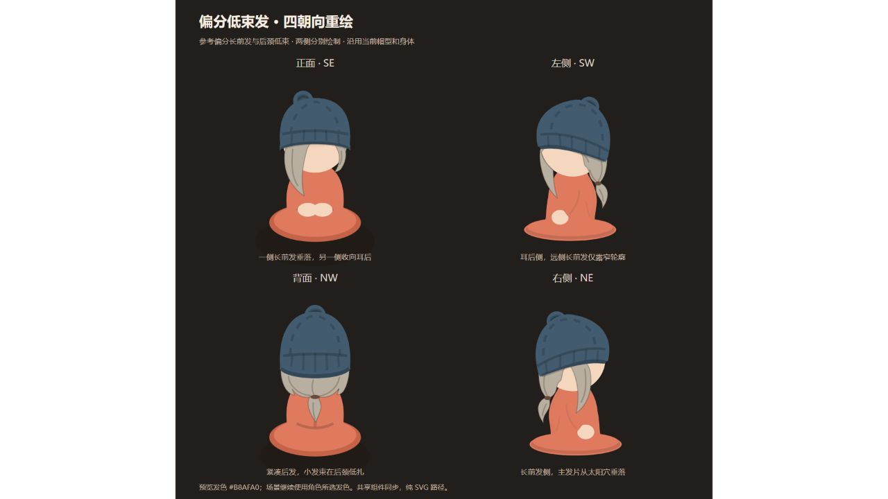
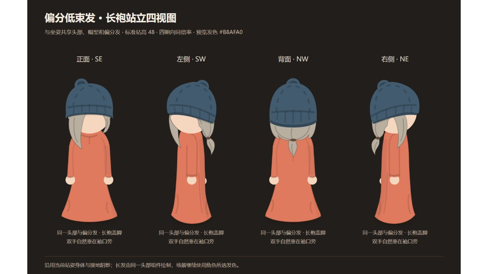

# 偏分低束发替换与精修

> 2026-10-18 图片精简：本文部分历史过程图已转为本地归档，保留的代表图与恢复方法见[图片精简清单](metrics/IMAGE_RETENTION_2026-10-18.md)。历史技术记录不代表当前造型已获认可。

日期：2026-10-14（Asia/Shanghai）。状态：当前为 v16 左右身份与侧面发量修正；坐站四视图及网页入口同步，观感待用户评审。

## 当前 v16：纠正侧面对应，补齐后枕发量

用户指出左右侧面与正面长短发不一致、侧面后脑过空、长前发过于靠前。复核正面和参考图后确认：正面画面左侧的长前发属于人物自身右侧，现有方向约定中 SW 露人物左侧，NE 露人物右侧。v14/v15 将两个侧面发型分配反了，之前仅检查两套侧面都存在，未覆盖它们与正面的解剖对应。

保留 v15 正面作为基准，将 SW 修正为耳后侧，NE 修正为长前发侧；方向标签、帽型与身体不变。SW 的远侧长前发只露脸外窄轮廓，NE 主发片移回太阳穴和脸侧平面，保留朝前的额头边缘。两侧共同补齐帽檐下至后枕、后颈的连续发量，收向低扎点，避免后发仅剩细条和发尾。后脑与发尾使用连续轮廓，绘制仍是静态 SVG 路径。

CharacterHead 根据真实 hairFacing 选择解剖侧面，茶桌西席的整个人物镜像仍使用 NE 发型，东席使用 SW。坐站总表、八个单图、场景头部和导出说明同步。正背单图及已有短发/卷发保留；睡姿本轮没有调整。

类型检查、生产构建及 8 项人物浏览器检查通过，覆盖桌面/390px 三款发型坐站导出、实际茶桌与睡姿兼容、35 张 SVG 的取景和资源。新增 SW/NE 身份对应与侧面后枕覆盖检查，并验证主发片覆盖太阳穴而保留前额边缘。短发及卷发 23 张资产重新生成后内容校验一致，本款正背坐站 4 张单图亦保持一致。IAB 核对两套四视图并保存截图，生产浏览器保存茶桌场景截图。本轮未新增依赖或动态计算，未采样性能；新观感仍待用户评审。

v16 茶桌场景（历史过程图 `character-sidepart-tea-scene-v16.png`，已本地归档）

## v15 历史记录：宽主发片、耳后收拢与连续发尾

用户指出 v14 与参考角色仍不相像。复核后确认：长前发太窄、太靠外，正面另一侧也有明显长尖条；发尾呈两瓣叶形，后发是过于光滑的半圆。戴帽遮住分缝后，这些轮廓不足以表达参考发型。

本轮重画正面主发片，根部向额头中部移动，增加脸侧宽度与弧度，遮住部分脸部后向领口收尖；另一侧收紧到耳后，删除原正面长尖条。长前发侧同步采用更宽的前发体积，耳后侧继续独立绘制。后脑加入收束方向和自然短发梢，发尾由连续曲线形成单束、单尖，修正两瓣叶状轮廓及扎点衔接。

毛线帽、头圆、身体、落座和站姿尺寸保留。睡姿同步调整宽前发及单束发尾，前发遮挡的一侧不再绘制闭眼与腮红，避免脸部细节浮在头发上。共享组件自动同步场景；坐站总表与八个单图使用原文件名重新生成，v14 截图保留作历史。

类型检查、生产构建及 8 项人物浏览器检查分组通过，覆盖场景与睡姿遮挡、桌面/390px 三款发型坐站导出，以及 35 张 SVG 的资源、取景与朝向。桌面复制检查曾在异步 fetch/clipboard 完成前读取旧结果，已改为等待预期 SVG 内容并重新验证桌面与手机流程。短发及认可卷发共 23 张 SVG 重新生成后校验值一致。IAB 核对新坐站四视图并保存截图。本轮未新增依赖、动画或每帧计算，未进行性能采样；功能验证不代表新观感已获用户认可。

v15 坐姿精修（历史过程图 `character-sidepart-seated-v15.jpg`，已本地归档）

v15 站姿精修（历史过程图 `character-sidepart-standing-v15.jpg`，已本地归档）

## v14 历史记录：替换披肩长发

用户要求删除原“随性披肩长发”，改成参考中的发型。参考身份线索是一侧较长、贴脸垂落的前发，另一侧向耳后收拢，紧凑后发在后颈低扎成小发束。只采用发型结构，沿用项目毛线帽、圆脸、无五官设定、当前身体和坐垫关系，不复制参考人物的衣服、表情、武器或围巾。

新增 SidePartHair：正面为一侧长前发与另一侧耳后收拢，背面为紧凑收拢轮廓、低发束与短发尾。此版曾将 SW 分配为长前发侧、NE 分配为耳后侧，和正面身份相反，已在 v16 纠正。使用两套不同发束路径，不能仅镜像同一个侧面。头发先于毛线帽绘制，由帽檐遮住发根；移除该款原先叠加的短发月牙刘海。短发与认可的长卷发保留。

既有 long_wavy / long 标识保留为兼容入口，但绘制及装扮名称改为“偏分低束发”，旧披肩路径及选项被替换，原角色配置自动显示新发型。CharacterHead 增加 hairFacing，供整个演员被镜像的席位指定真实发型侧面；主屋茶桌保留演员镜像和持杯方向，同时独立选择两侧发束。睡姿同步使用收拢发尾和偏分前发的简化形态，不残留旧披肩头发或短发刘海；未据此宣称完成全部睡姿资产校准。

参考图使用 #B8AFA0 暖灰发色，实际角色保留所选 hairColor。生成命令为 `node --import tsx scripts/generate-sidepart-character.tsx`，输出 `character-sidepart-4views.svg`、`character-sidepart-standing-4views.svg` 与两套 front/left/back/right 单图。左侧“人物 4 视图 SVG”中选择“偏分低束发”，可切换坐姿/站姿、打开完整页面、复制和下载总表或各单图。

类型检查、生产构建及 8 项人物浏览器检查分组通过：桌面/390px 三款发型坐站导出、总表复制和所有单图下载；35 张 SVG 的取景、朝向及实例引用；新装扮替换、实际场景和睡姿兼容；原蒲团共面和坐站尺寸。检查确认两个侧面分别使用长前发侧/耳后侧，后颈发束完整，无短发月牙叠加。原短发及卷发 23 张 SVG 重新生成后校验值均一致。IAB 核对两套四视图并保存截图。未新增依赖、动画或每帧计算，未进行新性能采样；及肩直发等剩余资产继续待后续。

偏分低束发坐姿（历史过程图 `character-sidepart-seated-v14.jpg`，已本地归档）

偏分低束发站姿（历史过程图 `character-sidepart-standing-v14.jpg`，已本地归档）
