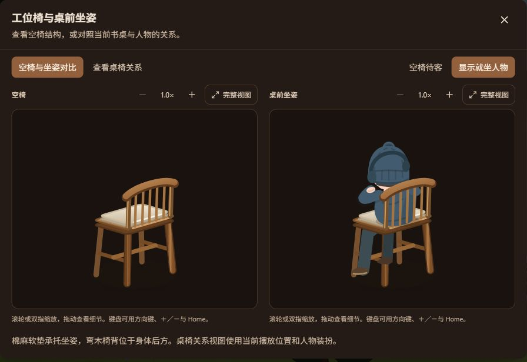

# 书桌椅与就坐人物：首个静态姿态样例

## 2026-10-15 最新需求：家具造型与布局继续评估

状态：**需求与候选方案已记录；下方已实施桌椅修订及技术证据保留。用户反馈当前单桌双席局促，新布局、新桌子及站台/手边桌均未实施、未技术验证、未最终验收。** 全局顺序见 [第三阶段前总入口](PRE_PHASE_3_ASSET_READINESS.md#6-当前优先顺序与历史顺序)，本文件继续维护家具局部步骤与证据。

### 已明确的需求

- [归档的用户布局草图](references/room-layout-user-sketch-2026-10-15.png)：窗和主桌略向右调整，主桌适度缩短，左前侧增加类似吧台的长案，右侧增加小升降桌，沙发旁增加放一盏灯和一个杯子的手边桌。草图表达方向，未确认实际尺寸和坐标。
- **原书架整座保留**：造型、层板、陈设及已有交互沿用。此前建议替换窄书架或把书架并入写字桌的方案已被用户否定。
- 用户不希望两张同向排齐的方桌形成公司工位/课桌的联想。靠窗桌、吧台、手边桌允许不对称和自由轮廓，不能用方/圆模板代替造型推敲。
- 右侧小升降桌**不配椅子**，仅供偶尔站着临时使用笔记本或一本书。它不承担第二个长期坐姿工位，也不能自动等同于新增长期容量。
- 若仍需两人同时长期用电脑，第二个完整位置在主桌/吧台方案中解决；是否及如何迁移现有第二桌席，待布局选择后核对保存兼容和席位行为，不因规划直接删改现有数据。
- 用户不会使用 Boxy SVG；由 Codex 制作/修改几何，用户以参考、描述及预览反馈。原人物造型、四款发型、圆手、长袍和软影保留，站姿临时桌需独立适配。

### 候选形态与待定事项

靠窗桌可比较浅凹前沿和不对称侧翼；吧台可比较沿敞口展开、宽窄渐变的缓弯长案；手边桌可比较弯木悬臂小托面；站台可比较轻巧小台面及简洁可调支撑。这些均为候选，尚未选定几何、材料细节或结构。

吧台与主桌独立摆放、短侧翼相连等讨论仍属备选；不把任何一张生成效果图当作实际摆位。生成图曾重绘书架、人物或房间留白，相关偏差不是改造要求。保留原书架和原房间比例后，必须重新检查通道与占地。

### 本专项局部步骤与检查

1. 参考 [性能诊断](SCENE_PERFORMANCE_DIAGNOSIS.md) 的当前成本证据，用 [最小校准工具](ASSET_AUTHORING_CALIBRATION.md) 在已有桌椅上验证接触点，再接一张新桌低细节轮廓。
2. 在实际坐标、投影和当前视角中比较主桌、吧台、小站台、手边桌；重点检查主桌椅后方、吧台两端、入口到茶席的路线及完整书架取用范围。
3. 核对全景、房间近景、窄屏及需要的两人同时使用状态，区分长期位置与临时站点；窗、挂件和柜子的关系一起检查。
4. 先选空间与形态，再逐件补细节；桌高、支撑落点、坐面、手部可达性、长袍接地和遮挡使用共享源。每件分别保存技术检查、成本对照及用户反馈。

屋顶体量与家具可见性的联合检查见 [生态屋顶专项](ECO_ROOF_VIEWING_PLAN.md)。新增家具的完成不自动启动屋顶、其他姿态或天气第三阶段。

## 2026-10-15 修订：坐高、长袍、耳机与双人工位

状态：**本次修订已实施，定向技术检查通过；新椅子、长袍坐姿和双人工位的观感待用户最终验收。** 本轮按用户确认的顺序执行空椅校准 → 单人坐姿及耳机 → 双人工位 → 状态与装扮检查。第三阶段未启动，人物其它席位没有在本批标记为完成。

### 当前几何与造型

- 桌面离地约 22.6，坐垫顶面从 19.4 降到 14.2，坐面约为桌高的 63%；桌板厚度从 4.5 调整为 2.4，桌面与坐面相差 8.4，桌板下沿与坐面相差约 6。尺寸为场景单位。椅腿、撑杆、坐垫和靠背同步定高，没有整体缩小椅子。
- `DeskSeatedCharacter` 以坐垫接触点放置身体与头部，长袍在髋膝处转折并垂到脚前，移除原裤腿和鞋；圆手与共用头部沿用。正常工作状态的双手落在各自键盘区，两侧肩腕都可达时才伸手；超出距离或休息状态则收手到膝上。
- `DeskHeadphones` 与 CharacterHead 使用同一 r=7 制作坐标和实际头半径，头梁在帽子外侧、耳罩位于两侧同高度；帽子、毛球和四款发型路径没有重画。
- 温莎椅保留木材与棉麻坐垫。第二席为固定四脚、无轮、无扶手的复古办公椅，圆角靠背与低饱和绿色软垫；两种椅子共用坐高、人物及接地关系。
- 两台笔记本、两只杯子和共享台灯沿桌面长边重新布置，两个工位具有独立的椅子、电脑、人物和手部锚点。世界与检视窗口共用 `DeskWorkstations`，按当前家具坐标装配。

### 占用、预览与旧布局

阁楼新增 `desk_workstation_secondary`，每席一人，第三人仍显示满员。固定人物列表的两人有各自席位偏好，另一人暂离不触发自动换座。显式房间优先和其它房间容量规则保持原契约。

工位查看支持温莎/复古椅的同倍率空椅与坐姿对比、实际桌椅关系、双人姿态样例。当前无人时实际关系保持空置，样例明确标注为示意。窗口内“只看空椅”仅控制预览显示，不改变实际人物、房间或容量；布局编辑器原有的第一椅显示覆盖仍是独立显示调试状态。

v6 存储 key 与坐标结构继续兼容。只在没有第二工位字段的旧布局中迁移与旧默认值完全相同的第一席物件；自定义位置保留，新版中手动设置回旧数值也保留。缺失的新电脑和椅子按现有桌子/电脑补位，两个椅子仍独立于桌子移动，电脑和杯子属于桌面。自定义布局不保证天然符合新双人工位空间，需通过当前关系视图核对。

### 本次验证与验收边界

- 最终 `npm run lint`、`npm run build` 通过，主包现存超过 500 kB 的提示保留；31 项单元检查通过，包含容量、暂离席位、旧布局迁移与手部可达性。
- 4 项开发场景夹具浏览器检查通过：桌面/390px 的 0/1/2/3 人输入，两席实际人物、各自键盘接触、长袍下沿，四款发型及耳罩贴合，单独移动第二电脑后仅第二人收手。测试使用独立端口 3181，保留用户的 3000 开发服务。
- 9 项生产浏览器检查分组通过：两种椅子查看、桌面/手机预览、无人不虚构实际占用者、样例资源 ID/引用隔离与真实占用不变，装扮保存/取消/焦点，头部比例，以及包含新增物件的全布局选择/微调。
- 初次单元检查发现新增默认坐标的浮点尾数差异，统一到四位小数后复验通过。未更新历史视觉基线；本次截图核对不等于用户已认可造型。


[实际双人场景夹具](metrics/desk-two-live-1200-2026-10-15.png) · [手机双人预览](metrics/desk-two-person-mobile-2026-10-15.png) · [复古椅对比](metrics/desk-retro-chair-study-2026-10-15.png)

四款头部/长袍细节：[经典短发](metrics/desk-robe-hair-short-2026-10-15.png) · [层叠卷发](metrics/desk-robe-hair-curly-2026-10-15.png) · [偏分低束发](metrics/desk-robe-hair-sidepart-2026-10-15.png) · [双色碎发](metrics/desk-robe-hair-shaggy-2026-10-15.png)。

### 当前生产正常动画样本

使用原性能脚本，1200×800、headless Chromium、DPR 1，仅一轮，默认一人占用工位、第二椅空置；CSS/SMIL 正常开启，不使用 stableScene。保存于 [原始 JSON](metrics/DESK-2026-10-15-current/dpr-1-run-1.json)。六场景有有效帧样本且无 page error，属于采样成功，不是流畅性通过。

| 场景 | P95 帧间隔 ms | 最大帧间隔 ms |
| --- | ---: | ---: |
| 午后全景静止 | 33.4 | 50.0 |
| 午后全景平移 | 50.1 | 66.6 |
| 午后滚轮缩放 | 83.3 | 83.4 |
| 导航到阁楼 | 83.3 | 83.4 |
| 阁楼静止 | 66.7 | 66.8 |
| 静雨全景静止 | 50.1 | 66.7 |

仍存在长帧。本次没有同条件修改前对照或重复运行，没有真实双人生产帧率、DPR 2、实际手机或 GPU 热点结论，不能与下方历史数据直接推导性能改善。采样期间不并行运行其它检查；未增加人物敲键盘动画或改变天气。

---

## 2026-10-13 历史试点记录

日期：2026-10-13（Asia/Shanghai）。状态：**当时的实现、技术检查和采样已完成；下方裤腿/鞋及高坐面已被上方 2026-10-15 方案替换。原始证据保留。**

本批对应 [前置评估](PRE_PHASE_3_ASSET_READINESS.md) 中的第一步：先修正书桌椅、空椅与就坐组合，并保存正常动画开启的生产测量。其余人物席位、猫狗姿态、草地变化和天气仍按独立批次推进。

后续用户补充人物比例应先明确，现已新增 [长袍站立四视图与比例稿](CHARACTER_STANDING_PROPORTIONS.md)。本文件保留书桌椅试点的完成记录；统一人物时须再按确认的比例校准此坐姿，不能将接触关系完成等同于人物比例已全面统一。

## 1. 实现结果

- 椅子坐面、软垫、四脚、撑杆和弯木靠背使用同一套局部家具投影，复用现有 `projectIsoToScreen`。四脚接触影随各脚落点放置；靠背在有人和无人时保持完整结构。
- 就坐人物增加弯曲的裤腿和鞋，躯干收在椅背前方，靠背按近侧层级覆盖人物下背。保留棉麻软垫、暖木材料和人物柔和接触影。
- 手的位置由实际书桌、笔记本和椅子的保存坐标计算；家具被独立移到明显无法触及的位置时改为收手，避免无限拉长手臂。这是静态姿态适配，不含敲键盘循环动画或自动移动家具。
- 复用现有 `CharacterHead`，保留帽子、发型、毛球、肤色和衣服设置；手掌使用实际肤色。
- 工位预览提供同倍率的空椅/坐姿对比，以及同步当前摆放的桌椅关系。预览缩放和拖动保持独立，不修改世界相机或 v6 布局。
- 预览使用工位实际占用者；工位无人时实际桌椅视图显示空椅、禁用恢复就坐按钮，并说明对比中的人物仅为姿态参照。恢复就坐只改变已有的椅子显示覆盖状态，不分配新人物。
- 椅子渐变使用实例 ID，预览继续通过 `SvgDetailView` 隔离资产 ID 和滤镜引用。为对比增加可选 `autoFit={false}`，其它家具预览保持原默认自动适配。

本批没有安装 Anatomy、Zdog、SVG.js、Paper.js、Rough.js 或 Maker.js。既有 SVG/JSX 足以制作此样例；工具研究不等于运行时引入依赖。

## 2. 视觉核对

在实际房间近景、独立空椅/坐姿对比和桌椅关系视图中核对了腿脚、坐面、手与键盘、靠背遮挡及暖木色调。全景仍使用原世界相机和布局。以下为开发浏览器的实际截图，交互验证另外使用生产构建。




[原预览截图](metrics/desk-chair-before.jpg) · [当前桌椅关系截图](metrics/desk-chair-context-after.jpg)

这是一轮静态样例的本地验收。人物造型的最终观感仍以用户体验为准；没有更新历史全景视觉基线来隐藏有意的美术变化。

## 3. 生产性能基线与对照

### 环境和方法

Windows / Intel Core i7-10710U / Chromium 141.0.7390.37，生产 `vite preview`，headless，1200×800，DPR 1 和 2，每种重复三次。默认人物与布局，陪伴面板收起；CSS 和 SMIL 动画正常开启，不使用功能测试中的 `stableScene`。没有 CPU 降速、追踪、录像或截图。

六个场景包括午后全景静止、固定平移、滚轮缩放、导航到阁楼、阁楼静止和静雨全景静止。每场景至少三秒，以墙钟时间取样，保留 rAF 间隔和主线程 long task 原始值。导航/缩放结果包含连续动画和后续绘制，**不是单次输入延迟**。

新增独立入口 `playwright.performance.config.ts` 与 `tests/performance/scene-performance.spec.ts`，不进入普通交互测试。命令需先完成生产构建：

```powershell
npm run build
$env:LWM_SCENE_METRICS_DIR = 'docs/architecture/metrics/PRE3-after'
npx playwright test --config playwright.performance.config.ts
```

输出目录应为每轮使用新名称，保留历史原始值。采样测试的通过条件只有存在有效帧样本及没有 page error，**六项通过不表示达到流畅性门槛**。

### 结果

下表为三次运行的 P95 帧间隔中位数，括号为三次 P95 的最小至最大值；单位 ms。前后测试配置一致，但宿主后台负载、温度和 GPU 条件未锁定，代码没有隔离成单一变量实验。

| 场景 | DPR | 修改前 P95 | 修改后 P95 |
| --- | --- | --- | --- |
| 午后全景静止 | 1 | 116.7（116.7–150.0） | 133.4（133.4–150.0） |
| 午后全景平移 | 1 | 149.9（133.4–150.0） | 150.1（150.0–183.4） |
| 午后滚轮缩放 | 1 | 233.3（233.3–233.4） | 299.9（266.6–333.3） |
| 导航到阁楼 | 1 | 233.3（199.9–233.3） | 316.6（283.2–316.7） |
| 阁楼静止 | 1 | 183.3（166.7–183.4） | 216.7（183.3–250.0） |
| 静雨全景静止 | 1 | 133.4（133.3–133.4） | 150.0（149.9–166.7） |
| 午后全景静止 | 2 | 133.3（116.6–133.4） | 149.9（133.3–150.0） |
| 午后全景平移 | 2 | 133.4（133.3–150.0） | 183.3（166.7–183.3） |
| 午后滚轮缩放 | 2 | 266.6（233.3–266.7） | 299.9（233.4–300.1） |
| 导航到阁楼 | 2 | 233.4（183.4–266.7） | 266.6（266.6–350.1） |
| 阁楼静止 | 2 | 183.4（166.7–233.4） | 200.0（183.4–216.7） |
| 静雨全景静止 | 2 | 149.9（133.4–150.0） | 166.7（166.6–166.7） |

本轮结果显示明显长帧；修改后整体采样更慢，**不能写成性能改善或无回退**。修改前已存在同数量级的成本。宿主负载未受控，不足以把差异归因于椅子改动；也不能据此忽略差异。修改后滚轮场景的最大帧间隔为 466.7ms，需要后续调查。

采样结束时 SVG 后代元素由 7068 降至 7019，运行 CSS 动画仍为 167、SMIL 为 3。元素变少没有在本轮证明速度提升。这些计数来自最终静雨全景，不能解释每个场景的实际绘制成本。

生产包的主入口由 848.29kB / gzip 219.66kB 变为 840.47kB / gzip 218.86kB；椅子预览分块由 14.52kB / gzip 4.64kB 变为 3.81kB / gzip 1.85kB。最终 CSS 65.35kB / gzip 12.67kB。主入口仍触发 Vite 500kB 提示，未调高阈值。

完整 P50、P95 范围、最大间隔、长任务及原始样本保存在 [汇总 JSON](metrics/PRE3-summary.json)、[修改前 DPR 1 示例](metrics/PRE3-before/dpr-1-run-1.json) 和 [修改后 DPR 1 示例](metrics/PRE3-after/dpr-1-run-1.json)，各目录保留六份运行文件。修改后采样使用最终椅子几何；随后补充的是无人预览与实际占用者文案，默认闭合预览的被测场景没有变化。

### 限制与后续入口

rAF 是主线程回调节奏，不等于显示器实际呈现 FPS。此次未测真实手机、IAB 正常显示帧率、GPU 栅格化、内存、首开预览响应或深夜主题，不能据此保证手机流畅。390px 功能检查只验证窄屏交互和布局。

在新增散步和天气动态前，下一项性能工作应先在受控前台浏览器中复测，再用短 trace 区分脚本、样式、绘制与栅格化成本。优先验证持续背景动画、大范围滤镜/遮罩和相机变换引起的整景绘制；不要仅根据元素数量删掉用户认可的投影。保存本轮基线供后续同条件对比，第三阶段 T3-0 仍需重新核对届时版本。

## 4. 验证范围

- `npm run lint` 与 `npm run build` 通过。
- 生产浏览器受影响回归：椅子、键盘交互、书架/柜子详细查看及三种视口的房间导航，共 12 项通过。
- 最后补充工位无人和换装同步后，椅子专属四项生产检查复验：桌面/手机的同倍率对比、键盘定位、空椅切换、布局与相机隔离、SVG 引用；工位无人不虚构人物；保存的肤色、衣服、帽子和毛球同时出现在实际坐姿与预览。
- 性能修改前六次、修改后六次采样完成，均无 page error；数据不满足流畅性结论。

未运行或宣称全量历史视觉快照通过，未修改原基线；本次有意改变了椅子和人物造型。
