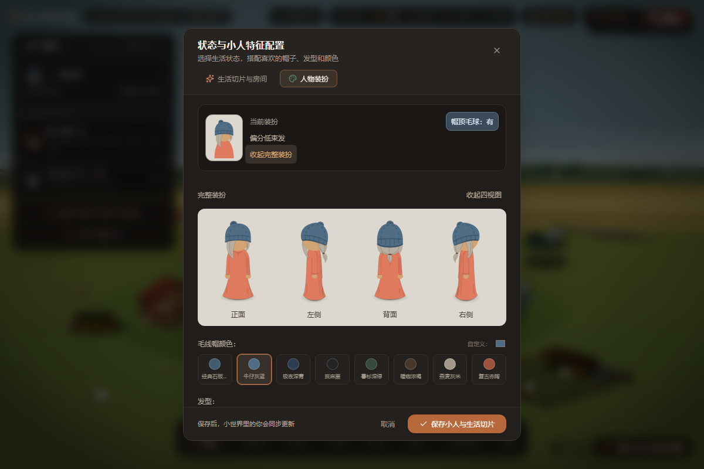
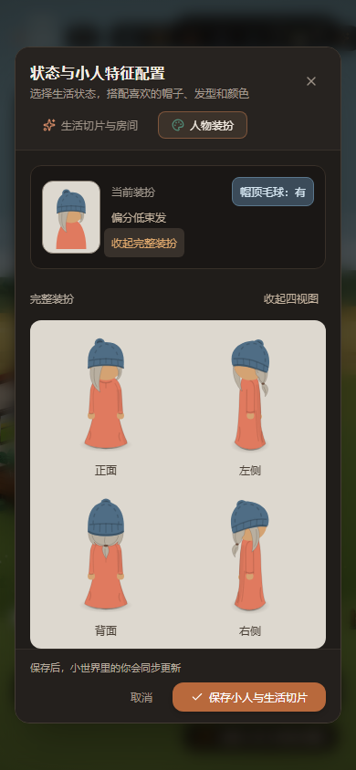

# 重构执行记录

> 2026-10-18 图片精简：本文部分历史过程图已转为本地归档，保留的代表图与恢复方法见[图片精简清单](metrics/IMAGE_RETENTION_2026-10-18.md)。历史技术记录不代表当前造型已获认可。

## 用户版NW收腿坐姿当前定稿（2026-10-16）

用户明确「那就暂时以我这版定稿」。**已实施：** 原稿、确认原话及哈希归档，直接提取用户身体路径接入当前独立SVG／总表／放大页与查看导出入口；保留定稿头部及原始统一缩放，仅处理文档定位／引用ID，原四图／站姿／原椅／布局保持。**技术验证：** 本轮全部路径／椭圆／头部变换／统一缩放对比、66项保护及SVG引用／模拟窄屏检查通过；类型、构建和同步结果见[定稿记录](metrics/NW-FLOOR-SEATED-2026-10-16/approved/README.md)，无性能或真实手机测试。**用户视觉：** 经典短发独立NW收腿方向本轮确认通过，作为当前基准，非椅坐或其它发型验收。本批只定稿同步，未自动入椅或启动其它专项，未提交／推送。

## 用户提供NW收腿SVG：v2方向纠偏（2026-10-16）

用户评价v2「还不如下面的」并提供SVG。**已实施：** 原样归档及同倍率矢量渲染对照，只撤销文档平移、不改路径；确认用户稿紧凑上身、清楚的袍摆顶面与袖手连接优于v2，撤回笼统加宽肩背／增加手掌露出的方向。后续以用户稿主轮廓为参照。[对照与原稿](metrics/NW-FLOOR-SEATED-2026-10-16/user-reference-review/README.md)。**技术验证：** 本轮无构建／功能或性能测试；**用户视觉：** v2未获认可，新稿未明确最终定稿。本轮没有替换产品或改原四图／头部／站姿／椅子／布局，其它专项不启动。

## NW收腿坐姿v2：按自查局部微调（2026-10-16）

用户授权「调整吧」。**已实施：** 仅经典短发新增NW身体补肩背、收短前侧斜边并接顺臀腿、修圆手与袖口、缩短淡化横向衣褶；头部和原袍摆／阴影保持。独立SVG／总表／审阅页3份静态文件同步4178，入口JS不变，无需重跑构建；v1源与截图保存。**技术验证：** 本轮类型、SVG引用／1340及390模拟宽度／66项保护检查和头部、袍摆、阴影对比通过，内置浏览器确认v2；见[本批记录](metrics/NW-FLOOR-SEATED-2026-10-16/v2/README.md)，无性能／真实手机测试。**用户视觉：** v2待审阅、未定稿。仅收尾独立方向，未入椅／放回房间，其它发型与专项不扩，性能暂停，未提交／推送。

## 新增NW收腿坐姿：微调前自查（2026-10-16）

用户反馈「还需微调」，要求自行分析。对照已有原四图／新增NW与放大稿，识别背部大面偏窄、前侧斜张与臀腿体积不足、袖口把圆手遮成月牙，以及横弧／背线和袍摆衔接问题。**已实施：** 分析及当前状态记录；**技术验证：** 本轮无新测试／构建／发布；**用户视觉：** 仍需微调、未定稿。本轮没有改图，建议先修肩背与臀腿，再袖手和布褶，固定定稿头部与原四图／站姿／原椅。[详细自查](metrics/NW-FLOOR-SEATED-2026-10-16/README.md)。其它专项不扩，性能仍暂停。

## 原坐姿四视图新增 NW 收腿方向（2026-10-16）

用户要求先根据坐姿四视图增加NW方向。**已实施：** 经典短发新增独立原生SVG、四图＋NW同倍率总表和放大审阅页；沿用原坐姿的收腿／宽浅袍摆，复用定稿NW头部，身体直接绘制，不沿用失败椅坐适配。人物5视图导出窗口新增短发坐姿第五项与查看／复制／下载入口，4178同步；原四图／站姿／椅子／布局保留，其它三发型坐姿未扩。**技术验证：** 本轮类型／独立构建通过，无头Chromium静态SVG引用／1340和390模拟宽度检查、66项原文件保护核对通过；内置浏览器实际确认导出窗口资源加载。对照页重复SVG ID已隔离后复核，无性能或真实手机测试。**用户视觉：** 新增收腿坐姿待审阅，原v3／v4／v5／v6椅坐仍未通过。[本批证据及入口](metrics/NW-FLOOR-SEATED-2026-10-16/README.md)。下一步只审阅此独立方向，未接入椅子／房间，其它专项不扩，性能暂停，未提交／推送。

## v6 再次被否定：造型与转换失真复核（2026-10-16）

用户明确当前产物仍不能使用。复核确认臀／大腿承托体积缺失、头身方向不一致；转换脚本人为将上身／大腿纵向压到相对水平约60.5%、垂袍拉到约123.7%，再加入剪切，破坏参考比例。这不是SVG格式限制，也不能推断去掉变换就会合格。**已实施：** 失败分析和当前状态纠正，停止沿用此适配方法；原图／定稿头部／原椅／布局及失败证据保留。**技术验证：** 本轮无新测试、构建或发布，上批功能结果不证明造型可用。**用户视觉：** v6明确不通过，v3／v4／v5仍不通过。[详细复核](metrics/NW-CHAIR-SEATED-2026-10-16-v6/REJECTED.md)。本轮不继续改图或自动启动下一次重画，其它专项不扩，性能暂停，未提交／推送。现用4178仍保留失败稿；下方待审阅为历史。

## 新背斜侧参考：完整身体重绘v6（2026-10-16）

用户提供新参考并要求重做。**已实施：** 内置image_gen生成完整身体制作参考，只读提取身体／明暗原生路径、按原椅坐高校准，替换v5身体；精确定稿头部和原圆手保留，参考打字动作不照搬，PNG／生成头部不进运行时。4178短发人物无遮挡／入椅／实际房间和独立SVG同步，原椅／布局／四图／站姿五图／书架／第二席不改，其他发型未扩。**技术验证：** 类型／独立构建及Windows无头Chromium1200／390模拟宽度2项集成通过，内置浏览器实际查看，53原文件／15本批保护／4定稿图哈希一致，无性能／真实手机测试。**用户视觉：** v6待审阅，v3／v4／v5均未通过。[源、提示词与证据](metrics/NW-CHAIR-SEATED-2026-10-16-v6/README.md)。下一步只收尾此人物，不扩专项，未提交／推送。

## NW 垂腿 v5 被否定：复核重复造型错误（2026-10-16）

用户明确不通过并指出每版相同。对照原参考和本轮截图，确认扁平L形／后腰尖块／大腿体积缺失、头部NW与身体纯侧面不协调及前臂细带问题。更换坐标与曲线没有更换错误轮廓，上一轮视觉审查未拦下失败图。**已实施：** 分析及失败状态记录；**技术验证：** 无新测试；**用户视觉：** v5未通过，v3／v4同样未通过。停止局部修补，完整坐姿造型重建尚未实施，原四图／定稿头部／椅子／布局保留。[失败复核](metrics/NW-CHAIR-SEATED-2026-10-16-v5/REJECTED.md)。

## 单款 NW 垂腿坐姿与独立 SVG（2026-10-16）

用户选择垂腿坐为首选并授权实施。**已实施：** 新独立 `NwChairSeatedCharacter`／`nwChairSeatedGeometry`，经典短发完整 NW 人物，复用定稿头部，身体按原椅坐标制作；独立 `character-shorthair-seated-nw-study.svg`、无遮挡／入椅／实际房间共用，4178更新并可下载。原四图／站姿五视图／装扮／原椅和布局／第二席／书架保持，其他三发型未适配。**技术验证：** 类型、独立构建、Windows无头Chromium1200／390模拟宽度2项集成用例通过，另在内置浏览器核对现用页面和房间；53原文件、15本批保护文件、4定稿图哈希一致。无性能或真实手机测试，未累计历史次数。**用户视觉：** 新稿待审阅，v3／v4仍未通过。[证据与更新备份](metrics/NW-CHAIR-SEATED-2026-10-16-v5/README.md)。下一步只按该单人反馈收尾，不扩其它发型／姿态／布局／天气，未提交／推送。

## 简化 NW 安坐 v4 未通过：只读复核（2026-10-16）

用户明确不通过，并询问先独立制作 NW 坐姿的作用。复核当前代码／已有截图：数值髋点在坐面内不代表可见轮廓受承托约束；坐法不明确、头身方向设定不足、接触影未清楚表达接触。原椅前向 -v 同样投影到左上，不支持直接判定椅子朝向相反。建议先单款独立无遮挡 NW 坐姿，以原椅为约束，再验证入椅；本轮未实施。**已实施：** 分析及拒绝状态记录。**技术验证：** 无新测试。**用户视觉：** v4、v3 均未通过。[分析](metrics/WINDSOR-NW-SIMPLE-2026-10-16/REJECTION_ANALYSIS.md)。原图／椅子／布局保留，性能与其它专项不启动。

## 温莎椅改用简化 NW 安坐（2026-10-16）

用户再次指出 v3 扭曲，并允许采用类似蒲团／沙发的 NW 坐姿。核对 v3 已使用定稿头部，问题是身体承托与袍身表达。**已实施：** 只重画第一名温莎椅人物为连续紧凑袍身包腿，取消长垂布／分段小腿，近侧圆手放腿上、远臂随视角遮挡；保持完整定稿头部及原四图／椅子／布局／第二席／书架／五视图接入。结构辅助、无遮挡／入椅／实际房间共用新稿，现用 4178 已同步。**技术验证：** 类型、独立生产构建、1200／390 模拟宽度 2 项集成检查通过，另查看四发型静态图；53 原保护文件、15 本批保护文件及4定稿图哈希一致。内置浏览器实际核对两幅对照及用户房间。**用户视觉：** 本简化稿待审阅，v3 未通过；不声称已复现参考图垂腿造型。性能暂停、天气未启动，未提交／推送。[本批记录与更新备份](metrics/WINDSOR-NW-SIMPLE-2026-10-16/README.md)。下一步只依本稿反馈收尾，未通过前不扩其它坐姿、布局或导出总表。

## 坐姿 v3 被否定；定稿 NW 正式入口补齐（2026-10-16）

用户明确温莎椅单人坐姿 v3 不通过，当前保留失败试稿、停止推进坐姿。**已实施：** 人物 5 视图 SVG 默认站姿五方向，四发型新增纯矢量总表及 NW 单项预览/复制/下载；完整装扮新增定稿 NW，跟随发型/全部配色/毛球并保存重开。原四图组件/资产和定稿 NW 均不改，坐姿窗口标记未通过。**技术验证：** 类型/独立构建与 4 项不同的桌面/390px 定向用例通过；首轮组合 ID 冲突已在新预览/总表隔离后复验，53 项原文件、4 定稿图和原装扮四图组件哈希一致，无性能测试。**用户视觉：** 站姿定稿保留；入口使用待反馈，坐姿 v3 明确未通过。

现用 4178 生产快照同步更新，新资源先复制、入口最后替换，旧覆盖文件备份，不停止服务、不操作浏览器装扮/布局存储。[证据与本地更新记录](metrics/CHARACTER-FIVE-VIEWS-2026-10-16/README.md)。本轮不扩坐姿/其它方向/家具/天气，未提交/推送。

## 温莎椅单人坐姿 v3：复用定稿 NW 头部（2026-10-16）

用户授权下一小批次后，**已实施：** 定稿 NW SVG 完整头部路径生成运行时片段，只整体统一缩放/平移装到坐姿；重画肩背至髋、大腿/膝和下摆的连续袍身，双手安放腿上，原椅背覆盖靠背侧。三种对照共用同人同几何，既有装扮/耳机/毛球选项保留；只处理第一张温莎椅，原四图/定稿 NW/原椅/摆放/第二席/书架不变。

**技术验证：** 类型检查、`build/windsor-study-v3` 生产构建通过；无头 Chromium DPR1，1200/390 桌面模拟下 6 项不同的定向用例通过。首次唯一功能失败为新测试将帽色/袍色预期写反，只修测试后单项通过，不累计重复。核对 53 项原保护文件、4 张定稿图与原椅/摆放等哈希一致，默认头部路径逐项相同；已查看无遮挡、入椅及实际房间近景，无性能采样或真实手机测试。

**用户最终视觉验收：** 坐姿待反馈，已有站姿发型认可不扩大。本轮 **4182**，原 3000/4180/4181 未操作；[证据与三种画面](metrics/WINDSOR-POSE-2026-10-16-v3/README.md)。下一步只收尾该单人造型，再回总入口布局，未启动其它方向/家具/天气或恢复性能，未提交/推送。

## NW 发型视觉定稿（2026-10-16）

用户明确「可以定稿」。**已实施：** 固定卷发第四轮、低束发第四轮、双色碎发第三轮，保存 SVG/制作源/哈希快照，原审阅页标注定稿；没有改造型。**技术验证：** 沿用第四轮静态验证，本次只核对当前四张资产及 53 项保护文件哈希，无新渲染或性能采样，不累计历史测试。**用户最终视觉验收：** 三款新增 NW 中性站姿发型通过。[确认原话与定稿文件](metrics/CHARACTER-NW-SVG-2026-10-16/approved/README.md)。下一批建议单个温莎椅人物坐姿与连续长袍，尚未启动；场景接入、其它方向、性能和天气未扩展，原四图/椅子/3000 保留，未提交/推送。

## NW 第四轮局部微调与部分视觉确认（2026-10-16）

用户确认第三轮双色碎发基本满足要求、低束发根正确。**已实施：** 仅收细/分开卷发短碎发，低束前发末段向面前侧略收并缩短；双色碎发、低束发根、卷发长发纹理、后脑/扎点/后方发尾保留。**技术验证：** Windows 无头 Chromium 桌面/390px 静态显示及 SVG 检查通过，53 项保护哈希与短发/双色碎发整文件一致，限定修改范围补核通过。**用户视觉：** 记录上述两项确认，本轮两处微调待反馈。[证据及原话](metrics/CHARACTER-NW-SVG-2026-10-16/hair-touchup-v4/README.md)。下一步只收尾这两处，不扩方向/椅坐/性能/天气；3000、原四图及既有工作保留，未提交/推送。

## NW 发型第三轮：按四视图局部修订（2026-10-16）

用户反馈卷发纹理密/侧边碎发缺失、低束前发错位、双色碎发勉强合格但侧边密且等长。**已实施：** 对照完整四图，合并卷发重复片界并补帽下短发梢，低束远侧前发根部退入脸后，碎发调整侧面束宽/长短与间距；审阅页新增完整原四图。**技术验证：** Windows 无头 Chromium DPR1 桌面/390px 静态 SVG/加载/无溢出检查通过，53 项保护哈希与短发整文件不变，共用头位/脸底形/帽子/身体/软影逐节点保持。**用户视觉：** 第三轮待反馈，第二轮双色碎发“勉强合格但需调整”，不记最终验收。证据与修改前文件独立保存于 [hair-refinement-v3](metrics/CHARACTER-NW-SVG-2026-10-16/hair-refinement-v3/README.md)。

下一步审阅本轮局部造型，尤其低束发露出位置。无新产品代码/全量构建/性能采样，不扩椅坐/布局/天气，原四图和 3000 保留，未提交/推送。

## 三款 NW 发型第二轮重绘（2026-10-16）

用户明确授权按分析重做三款。**已实施：** 按卷发→低束发→碎发逐款重绘；可见后脑发体在皮肤上覆盖，保留远侧前发的遮挡；卷发改层叠长束，低束发形成连续后枕/扎点/单尾，碎发增加发束宽窄与长度差。原入口增加三款头肩、全身及原侧/背和旧失败稿对照。修改前资产/源和本轮证据独立保存在 [hair-redraw-v2](metrics/CHARACTER-NW-SVG-2026-10-16/hair-redraw-v2/README.md)。

**技术验证：** Windows 无头 Chromium DPR1，1200×1000、390×844 静态显示/资源/无溢出通过；四 SVG 可解析、透明、无位图或脚本，53 项保护文件与短发 SVG 整文件哈希不变；三款脸底形/帽子/长袍/手/袖口/软影逐节点与修改前相同。已查看头肩、全身和方向参照；未做产品全量构建或性能采样，不累计历史检查。**用户最终视觉验收：** 本轮待审阅；此前三款失败记录保留，原 v4 短发二维认可范围不扩大。

下一步按这三款反馈收尾，再决定接入/椅坐；原四图/发型组件/椅子/布局未改，性能继续暂停，天气未启动，3000 未动，未提交/推送。

## 三款新增 NW 发型被否定：只读分析与状态纠正（2026-10-16）

用户明确另外三种发型均不合格。复核新路径、原侧/背单图和三份发型修订记录，保存三张放大对照；结论为发型转向与结构设定不足：卷发过度尖齿/平片化，低束发的左右身份、后枕发量及连续扎束关系散乱，碎发的浅深层被画成规则齿带。短发皮肤底形和粗分前/后层的共用方式也妨碍其它发型的正确遮挡。[详细分析](metrics/CHARACTER-NW-SVG-2026-10-16/HAIR_REJECTION_ANALYSIS.md)。**已实施：** 仅分析与状态更新，未改人物几何。**技术验证：** 本轮无新增测试；上批文件技术结果不等于造型通过。**用户视觉验收：** 三款新 NW 明确不通过；短发 SVG 尚待确认，原 v4 二维短发认可不变。下一次先单款重建关系，不自动实施重画或其它专项，原四图/椅子保持原样。

## NW 四发型原生 SVG 与同倍率对照（2026-10-16）

按用户“实施吧”授权，将认可的短发 v4 轮廓/头肩位置制作成独立路径 SVG，再新增长卷发、偏分低束发、双色蓬松碎发的 NW 发片与遮挡。新增四个 `public/character-*-standing-nw.svg`、共用制作源和 SVG 审阅页；原四图/发型源、旧 NW=背面、椅子及布局不改。没有 `<image>`/base64 或模型替代，SVG 约 30–31 KB/款。

**已实施：** 四款 SVG 及原稿/转换稿、四发型/原方向对照。**技术验证：** Windows 无头 Chromium 1200×1000、390×844 下解析/解码、透明四角、无位图/脚本、页面无异常和溢出；53 项保护文件哈希通过，共用脸部底形与头部变换一致。首轮下摆曲线过冲已修正，最终短发不透明轮廓交并比约 99.43%，脸左外缘平均偏差约 0.71 源像素；近似重建不代表像素复制或视觉通过。**用户最终视觉验收：** v4 二维短发已通过，新 SVG 和另外三发型待审阅。详见 [本轮证据](metrics/CHARACTER-NW-SVG-2026-10-16/README.md)，未重复计历史检查。

当前 4181 `/character-standing-nw-svg-review.html`，旧无版本入口同步，认可 v4 固定页保留。未接入房间/运行时换色或椅坐，未扩其它方向；本批仅静态资产及制作脚本，无产品构建/性能复测、无新依赖，3000 未动，未提交/推送。

## 用户确认经典短发 NW 二维造型（2026-10-16）

用户明确“那就这版吧”，当前 v4 的头肩位置、脸型和底部软影作为经典短发 NW 中性站姿基准。**已实施：** 既有定位稿。**技术验证：** 沿用 v4 记录，本次只更新用户确认，无新增检查。**用户最终视觉验收：** 此二维造型通过；最终 SVG、运行时接入和其它发型 NW 未实施/未验收。下一步先把短发稿制为独立 SVG，再逐款补其余三种发型的 NW 发片与遮挡关系，不改原四图/椅子，不扩展其它方向或椅坐。[确认记录](metrics/CHARACTER-NW-2D-2026-10-16/v4/README.md)。

## NW：按 v2 位置参照微调，锁定原脸型与软影（2026-10-16）

按用户最新明确要求，v4 定位页参照 v2 的头肩位置，沿用 v1 原头部、脸型和底部软影；不使用新的生成图，不缩放或旋转头部。当前入口同步 v4，历史页保留。**已实施：** 同倍率头肩/全身和下摆对照。**技术验证：** Windows 无头 Chromium 桌面/390px 静态显示、53 项保护文件及 v1/v2 哈希通过；底部在同一显示位置与完整 v1 截图一致，已查看头肩/下摆截图。**用户最终视觉验收：** 待反馈。[证据](metrics/CHARACTER-NW-2D-2026-10-16/v4/README.md)。没有新 PNG/最终 SVG，不继续其它方向/坐姿/性能，3000 未动，未提交/推送。

## NW 收头调整被否定，撤回完整原稿（2026-10-16）

用户指出 v3 头部挪动后不自然，撤回此前改善判断。当前入口及原 v3 链接恢复完整 v1 PNG，取消头部分层/裁切/位移，保留原头身位置、脸型和软影；旧 v3 另存历史页，历史脚本不再覆盖当前入口。53 项保护文件及 v1 哈希核对通过，[撤回证据](metrics/CHARACTER-NW-2D-2026-10-16/v3/withdrawal.json)。**已实施：** 撤回。**技术核对：** 原图来源与保护文件一致。**用户视觉：** v2/v3 已否定，v1 原先的轻微头前伸意见仍待解决；未制最终 SVG，不继续其它方向/坐姿/性能。未提交/推送。

## NW v3：恢复原脸型与柔和下摆影（2026-10-16）

按用户反馈撤回 v2 的脸型和阴影变化。本次 image_gen 尝试仍产生厚影与过度收头，归档未采用。改为静态页原 v1 图片分层定位，头部只后收 12 源像素，原脸型/帽形、袍身与软影均复用，新增头肩/全身/下摆对照。v3 是 HTML/CSS 审阅稿，没有新 PNG 或最终 SVG。**已实施：** 上述预览。**技术验证：** 本轮 Windows 无头 Chromium 桌面/390px 图片及静态页检查、53 项保护文件与 v1/v2 哈希不变，已查看截图。**用户最终视觉验收：** 待反馈。[证据](metrics/CHARACTER-NW-2D-2026-10-16/v3/README.md)。不计历史检查；无性能测量，原四图/椅子/3000 未动，未提交/推送。

## NW 二维候选 v2：头部轻微后收（2026-10-16）

按用户“调整一下”授权，内置 image_gen 以 v1 为编辑对象，生成独立 v2，轻微后收头部并接顺后颈与领口。v1 保留；最新静态页新增两版头肩/全身对照，按袍身中心近似配准，原 v1 页面另存。生成有少量帽形、袍身及影子差异，不能当作精确几何平移。

**已实施：** v2 及审阅页。**技术验证：** Windows 无头 Chromium 桌面/390px 图片解码、无横向溢出/脚本/页面异常、透明角和 53 项保护文件及 v1 哈希不变。**用户最终视觉验收：** 待反馈。详见 [v2 证据](metrics/CHARACTER-NW-2D-2026-10-16/v2/README.md)。只做图片/静态页检查，未做产品构建或性能复测；3000 服务未动，未提交/推送。先确认这一方向，再制作 SVG。

## NW 二维候选 v1 与头肩对照（2026-10-16）

用户指出程序模型肩部不协调，三维旧稿保留为未通过试稿，暂停继续投入。按用户“实施”授权，用内置 image_gen 将原四张站姿及左/背放大作为参考，只生成一张经典短发 NW 二维中性站姿候选。候选原图逐字保存，新增原四图并排、头肩三图放大和静态审阅入口。原四图/人物/椅子和当前场景未改，最终 SVG 尚未制作。

本轮图片透明度、原文件 53 项保护哈希、桌面/390px 解码/溢出/无脚本及页面异常检查通过；显示校准到原背面实际帽顶/袍底后复验，未累计历史检查或测帧率。输入与提示、候选、检查及实际差异见 [二维证据](metrics/CHARACTER-NW-2D-2026-10-16/README.md)。当前入口 `/character-shorthair-standing-nw-2d-review.html`，沿用独立 4181 服务，3000 未动。

**已实施：** 二维候选和审阅材料。**技术验证：** 图片与展示范围通过。**用户视觉验收：** 未收到；生成渐变、袖口/手位和袍身宽窄仍需反馈。确认后再重建 SVG，不把 PNG 包进 SVG，不自动继续其它方向、椅坐或布局；性能暂停。未提交/推送。

## 新增 NW 单方向站姿稿（2026-10-16）

用户将下一步收窄为八方向之一的 NW 斜侧人物，并明确选择中性站姿。已使用现有 Three.js 做独立三维制作源与固定正交相机，新增经典短发 PNG / GLB / 静态原四图对照页。原 NW=背面契约不变，新稿独立标识；房间人物、椅子及布局没有接入新模型。旧四图和相关源文件等 53 个受保护文件哈希前后一致。

类型检查和完整导出/查看流程通过，修正初图亮度/袖根及静态页检查条件后复验；PNG 透明、GLB v2/正交相机、实际面朝左上、桌面/390px 和无页面异常已核对。证据见 [CHARACTER-NW-2026-10-16](metrics/CHARACTER-NW-2026-10-16/README.md)。未重跑整个产品生产构建、未做性能测试；4181 独立审阅页，原服务保留。

**已实施：** 一个 NW 站姿方向稿。**技术验证：** 上述有限范围通过。**用户视觉验收：** 待反馈。椅坐 v2 仍未认可，当前先审阅方向/比例，不继续完整八方向、新布局或第三阶段；性能暂停。未提交/推送。

## 椅坐 v2：用户参考关系重建，双手放腿（2026-10-16）

用户提供四张椅坐参考，要求只参考承托、长袍和放腿手臂关系，原四视图及原椅子不改。本轮重建温莎椅人物的肩髋膝、连续袍身、自然袖口、放腿圆手和新增背侧头部；不再根据 coding 等状态自动抬臂。原椅子文件、椅子几何和摆放文件逐字哈希前后相同，原四视图/发型源/public 导出相对 HEAD 无改动。复古椅未重绘，工具的温莎椅提示/辅助线同步安坐稿。

新增按需坐姿结构参照，三种对照共享人物与几何；独立检视改用已有浅底，场景不挂结构辅助层。本轮类型、生产构建、8 个不同浏览器用例通过；最后头颈收尾后 3 项新姿态用例复验通过，不重复计数。当前生产预览 4180，4179 保留旧稿，3000 未动。四参考已归档；测试、截图和保留范围见 [v2 证据](metrics/WINDSOR-POSE-2026-10-16-v2/README.md)，最终造型待用户审阅。完整八方向未制作，暂不推进其它席位、家具布局或天气。性能继续暂停，未提交/推送。

## 温莎椅单人姿态与三种对照（2026-10-16）

按最新用户要求，把重点从桌面校准工具转回人物：仅温莎椅新增独立背侧头部和连续宽松椅坐长袍，保持原四视图和四款发型绘制源、导出资产不变。复古椅及其它人物姿态保持原实现。新增“温莎椅单人姿态”入口，提供同倍率无遮挡／就坐画面，可返回同一真实人物的实际房间；空席仍为空席，未改 v6 保存布局。首轮截图后调整袍摆及影子沿地面斜向接地。

本批类型检查、生产构建、7 个不同浏览器用例通过；最终接地修订后两项新用例复验通过，不重复计数。原四视图源及 public 资产相对 HEAD 无差异，diff whitespace 检查通过。实际证据、环境、限制及构建哈希见 [WINDSOR-POSE-2026-10-16](metrics/WINDSOR-POSE-2026-10-16/README.md)。新增独立 4179 预览，3000/4177/4178 保留，未提交/推送。

**已实施：** 单人姿态与审阅入口。**技术验证：** 上述有限功能范围通过。**用户最终视觉验收：** 待反馈，不能由测试判断造型自然。下一步先据反馈完善该单人，暂不推进家具布局、其它席位或天气；性能专项保持暂停。

## 最小接触校准工具与单桌草样首版（2026-10-16）

用户授权按总入口推进下一步，已实施 [工作台首版](ASSET_AUTHORING_CALIBRATION.md#6-2026-10-16-首版实施与单桌草样)，入口为工位椅检视中的“接触校准 · 草稿”。支持桌高/厚度/宽度、有限椅子/键盘锚点拖动与数值调节、坐面/桌脚/桌面/肩腕可达辅助线、原稿对照、撤销/恢复、JSON 和无辅助线 SVG 导出；新增一张浅凹异形桌低细节草样。坐高仍为既有 14.2，不重画人物。

同一草稿可临时放回真实房间和全景，实际身份/容量不变；结束试放或关闭工具恢复原稿。正式布局编辑器在试放期间隐藏，草稿不写 localStorage/v6，不修改书架和自定义布局。工具窗口返回试放保留草稿与撤销历史。未增加运行时依赖，没有正式应用新桌型、移动家具或实施屋顶。

本轮 `npm run lint`、独立生产构建和桌椅接触单元检查通过；五项定向浏览器检查分组通过（新工具 1200/390px 两项、旧检视桌面/390px 和无人席位三项），最终隔离/导出/画面补充后复验两项新工具检查。覆盖有限拖动、可达收手、撤销、原稿对照、桌高同步、导出 XML/引用、场景共享、结束恢复、自定义保存逐字不变和真实身份不变。初次单元启动受沙箱 spawn EPERM 限制，获权限后通过；早期手机元素截图被滚动裁切，已补实际视口截图，原文件保留。使用独立 4178，未停止/重启 3000 或当前 4177。

实际工具、房间、全景及窄屏证据见 [DESK-STUDY-2026-10-16](metrics/DESK-STUDY-2026-10-16/README.md)。功能截图使用 stableScene，未恢复性能专项或测帧率；真实手机未测。**已实施：** 最小工具和可审阅草样。**技术验证：** 上述范围通过。**用户最终验收：** 工具工作流及新桌型/尺寸/布局待评审，双席局促未解决。下一步先审阅这张实际场景草样，再按反馈进入布局粗样；不自动正式替换新桌或启动第三阶段。未提交/推送。

## 用户决定暂时结束性能专项（2026-10-16）

用户表示电脑本身可能较卡，明确要求“性能这一项暂时到这里”。已将性能专项和总入口标记为暂缓继续排查：保留草花、光带、云雾三项小修及全部原始证据，镜头卡顿作为未解决事项保留，不追加测试、缓存或渲染改造。宿主负载未受控，设备因素与项目开销尚未完全分离，不将现有样本解释为全部由项目造成或性能已全面通过。

下一步回到最小校准工具与单桌试点；本轮仅更新状态和交接，未改产品代码、未运行新性能/功能测试、未自动启动其它专项。既有技术验证与用户最终验收继续分开记录。

## 镜头缩放最小对照（2026-10-16）

按用户授权只追加一个简单步骤：同一 4177 构建，两条路线各一次正常/仅平移配对。四层倍率固定在 0.66，平移目标/时长/房间状态保持原逻辑；记录确认倍率固定。阁楼最大 rAF 间隔 1000.9 → 366.9ms，公共起居角 900.8 → 400.3ms，支持缩放相关成本重要，但仅平移仍有明显断档。控制组构图/可见面积不同，不能当作可交付优化或唯一栅格原因证明。详见 [性能专项第 10.1 节](SCENE_PERFORMANCE_DIAGNOSIS.md#101-缩放与仅平移的最小对照)。本轮仅扩展诊断脚本并保存证据，产品镜头未改，无新性能改善/视觉验收，不引入缓存或更换渲染器。

## 两条镜头切换轻量核查（2026-10-16）

根据用户对当前预览卡顿的反馈，只检查全景 → 阁楼、全景 → 公共起居角，详见 [性能专项第 10 节](SCENE_PERFORMANCE_DIAGNOSIS.md#10-两条镜头切换的轻量核查2026-10-16)。复用已构建 4177 版本，有窗口 Chromium / 1200×800 / DPR 1，两条路线各一次；正常动画、草花静止阶段开始。点击后主要 rAF 断档分别约 667 / 634ms；四层均执行一次 400ms 过渡，无取消/重启记录。确认渲染时序断档仍存在，不能只靠调缓动解决，未宣称实测物理呈现帧率。

额外各一次临时 `will-change: transform` 对照未显示收益，未写入产品。新增 `scripts/check-camera-switch.mjs` 与原始记录/文档，产品源文件保持上一批状态，无新运行时修正或用户验收；未重跑构建和无关测试。首轮公共导航名称定位错误已用页面显示名修复并另存结果，历史记录保留。当前范围到此结束，不扩成全场测试；镜头缩放成本仍开放，静态资产计划保持。

## 草花间歇阵风、麦田光带与云雾小修（2026-10-15 实施，10-16 收尾）

用户授权后三项已实际实施，详见 [性能专项第 9 节](SCENE_PERFORMANCE_DIAGNOSIS.md#9-草花间歇阵风与低感知动效小修2026-10-15) 和 [独立原始证据](metrics/BREEZE-2026-10-15/README.md)。草花每株按原错峰摇一轮（4–4.6 秒），每 30 秒一阵，共享 12 秒窗口后至少 18 秒静止；默认场景全部动作约 9.06 秒内结束。麦田两条淡光带 opacity 固定 0.18；云雾固定在原起始位置，保留主题渐变、滤镜和视差。9 簇麦穗、炉火等其它动态未改，没有替换渲染器或修改人物/书架/软影/布局。

独立生产构建 before/after 位于 build 目录，4176/4177 预览，不操作 3000。类型检查、两次生产构建、目标浏览器行为检查通过；有窗口 Chromium 141、1200×800、DPR 1、默认三人、固定种子，前后各约 35 秒全景样本：P95 66.9 → 33.6ms，最大 133.5 → 66.8ms，>50.1ms 间隔 275/764 → 6/1044。100 个草花动画在静止期均停止，下一阵重启；减少动态/恢复、静态云雾/光带、时段渐变、滚轮后阁楼导航检查完成。全景/阁楼截图已看，无明显资产缺失。没有跑全矩阵或无关全站测试。

一次顺序样本支持保留组合，不给长期改善比例、不区分三项各自收益；OS 持续前台、真实手机、内置浏览器性能未验证，缩放长帧未宣称解决。切换测试标签页的补充检查未使 document 隐藏，故隐藏生命周期仅实现、未取得真实隐藏验证，记录保留。静态截图不代替用户动感验收。

**已实施：** 三项小修。**技术验证：** 本轮构建/类型及目标行为通过，局部样本改善。**用户最终验收：** 待反馈。本批收尾，下一步恢复最小校准工具与单桌样例；第三阶段未启动。无提交或推送，已有未提交成果与历史原始数据保留。

## 按用户反馈收缩性能后续范围（2026-10-15）

用户优先快速推进场景，并希望控制未来推倒方案的风险。已将 [性能专项第 8 节](SCENE_PERFORMANCE_DIAGNOSIS.md#8-下一小批次局部渲染优化实验计划未实施) 和总入口 1b 收缩为具体 CSS 动画排查与小修，替代下方上一版固定多 DPR/多场景/各三轮要求。先找动画、选简单替代，只对影响场景短测和目视/交互核对，含糊时再补测，不建立新的固定测试工程。

本轮只读核对已找到草花/麦浪/光斑、云雾、炉火及雨幕等动画入口；草花已经使用 transform，不能把通用 CSS 建议当成已验证修复。具体热点仍需局部开关确认，未改运行代码或新增性能采样。家具/人物/布局继续 SVG，动态效果与资产尽量分开；未来天气先做代表性真实场景小样，再扩展，以控制返工范围。文档已修订，性能小修未实施、无新增性能或用户视觉验收。

## 性能工程结论与下一批计划入档（2026-10-15，仅文档）

按用户要求补充测试对后续开发的实际意义，详见 [性能专项第 7–8 节](SCENE_PERFORMANCE_DIAGNOSIS.md#7-诊断后的工程决定2026-10-15)。当前保留 React + SVG；持续静止长帧主要指向 CSS 动画与 SVG 渲染管线，缩放需关注栅格化和主线程工作，仅增加 memo 不足以解决。静态 SVG 可继续小样但需测挂载/缩放成本，持续动画与大面积环境效果需先验证局部更新方案；Canvas/WebGL 只保留为特定环境层的后备比较候选。

[总入口第 6 节](PRE_PHASE_3_ASSET_READINESS.md#6-当前优先顺序与历史顺序) 增补 1b 为下一批：选一个热点、实施一个局部候选，保留正常动画与已认可细节，同条件前后重复测量并检查真实场景画面/交互，明确保留或撤回后结束；随后回到最小校准工具。此更新替代下方此前“诊断后直接进入第 2 项”的继续建议，不要求所有长帧先清零，不启动第三阶段。

**已实施：** 文档结论与执行计划，未改运行代码、依赖、用户布局或历史原始数据。**技术验证：** 本次仅检查文档差异及本地引用，未重跑构建、功能或性能测试，无新增性能改善结论。**用户验收：** 无新增视觉或流畅性验收。局部优化实验仍为待执行。

## 当前长帧诊断首批（2026-10-15）

实际执行总入口第 1 小批次，详见 [性能专项第 6 节](SCENE_PERFORMANCE_DIAGNOSIS.md#6-2026-10-15-当前版本诊断) 和 [独立证据目录](metrics/PERF-2026-10-15/README.md)。开始时 HEAD `60378cd`、工作区干净；生产构建与类型检查通过，使用独立 4175 端口，未停止 3000 服务。新增诊断及汇总脚本，正常动画、固定种子、默认三人状态（桌前一人），headed/headless DPR 1/2 各三轮、每轮十场景；另有两模式空白页/简单合成校准、八项各三轮局部对照，以及 13 段探索和 7 段带时间窗标记的 trace。原始 JSON、逐场检查点、压缩 trace、构建/浏览器/GPU 信息和完整汇总均保存；不覆盖历史 PRE3/DESK。

有窗口 DPR 1 的三轮 P95 中位数：午后全景 66.8ms、阁楼 67.0ms、滚轮 467.1ms、导航阁楼 300.2ms；滚轮最大 rAF 间隔 534ms。无头 DPR 1 对应 50.0/83.3/116.6/100.0ms，不能作为前台改善。有窗口空白页 P50 33.4ms、无头 16.7ms，宿主调度差异明确；OS 持续前台/无遮挡核查未成功，内置浏览器只做加载/画面检查、未取得帧样本，真实手机未测。没有把 rAF 当实际呈现 FPS。

静止段通常 0 次 React 根提交；trace 显示持续样式/绘制、GPU 进程工作，缩放时 RasterTask 大幅增加。全部 CSS 动画暂停对照较稳定地接近宿主空白页节奏；仅停 SMIL 接近正常，植被/云雾/滤镜单项存在场景差异或波动，未锁定唯一元件。录制开销、GPU 进程时间非纯硬件时间、事件嵌套/线程重叠、滚轮长任务及未控制的温度/后台负载均写入限制。前两次采样器的折叠面板入口定位失败，环境文件保留并排除；正式基线重新完整采集，不把失败尝试或历史通过次数记成本轮验证。

**实施：** 测量工具和证据/文档；`src/`、书架、人物与发型、软影及保存布局没有修改。**技术结论：** 取得可重复成本起点，主要方向为 CSS 动画及 SVG 绘制、缩放栅格/合成管线，仍有长帧；未实施产品运行时修正，不能声称改善。**用户验收：** 本批无新视觉方案，未确认流畅，单桌双席局促反馈保留。两份新增脚本语法检查和文档空白检查通过；未运行不相关全站测试。

后续按总入口第 2 项进入最小校准工具，先验证现有桌椅接触点与按需挂载成本；新桌轮廓/布局需实际场景样例审阅。本批没有自动启动工具、屋顶、新家具或第三阶段，也不新增“全部长帧必须清零”的资产门槛。

收尾服务核查：独立 4175 返回 HTTP 200；127.0.0.1:3000 拒绝连接。初始 TCP 枚举因权限不足未成功，无法确认 3000 离线时间/原因；本批没有对其发送停止/重启操作或自动占用端口。4175 预览保留供检查，临时采样浏览器与内置浏览器标签均已关闭。

## 第三阶段前总计划与专项记录统一（2026-10-15，仅文档）

按用户要求更新 [资产准备总入口](PRE_PHASE_3_ASSET_READINESS.md#6-当前优先顺序与历史顺序)，明确当前优先顺序与原第 0～5 项的对应关系，保留历史成果及其他姿态、猫狗、草地和必要远景待办。新增 [性能诊断](SCENE_PERFORMANCE_DIAGNOSIS.md)、[资产校准工作台](ASSET_AUTHORING_CALIBRATION.md)、[生态屋顶](ECO_ROOF_VIEWING_PLAN.md) 详细记录；家具新需求继续写入 [书桌椅记录](DESK_CHAIR_STATIC_REFINEMENT.md)，并关联天气规划、设计入口及交接文档。

记录完整书架保留、单桌双席局促反馈、自由桌型、无椅临时小站台、用户不会使用 Boxy SVG、单层可悬浮生态屋顶及风格参考边界。用户布局草图与屋顶风格参考原样归档至 `references/`。本轮只更新文档和参考图，未更改运行代码、安装依赖、执行新功能/性能测试或修改保存布局；新诊断、工具、家具布局、屋顶及第三阶段均未启动。既有技术检查和采样继续作为历史证据，新方案的实施/技术验证/视觉验收分别保持未完成。

文档核对：检查本轮 9 份文档的 140 个本地链接/锚点，均有效；两张参考图与来源文件的 SHA-256 一致；已跟踪文档的 `git diff --check` 通过。这些仅为文档与归档完整性检查，不计作新资产、工具或性能技术验证。

## 书桌椅长袍坐姿与双人工位修订（2026-10-15）

按用户确认的顺序，先修空椅坐高与桌面关系，再替换桌前长袍身体和耳机，随后接入第二种椅子、第二电脑与实际第二席位，完成状态和发型检查。坐垫 19.4 → 14.2，桌面约 22.6、厚度 2.4；温莎椅与无轮无扶手的复古软垫椅共用坐高。新身体移除裤腿和鞋，头部/四款发型保留，耳机共享头部尺寸基准，双手按各自肩腕可达性对齐键盘。世界与检视复用桌椅装配；预览空椅切换不改真实占用，双人示意明确标注。v6 保留自定义布局，仅迁移旧版完全未改的默认物件并补新增物件。详见 [当前修订、截图与历史证据](DESK_CHAIR_STATIC_REFINEMENT.md)。

最终类型与生产构建通过，31 项单元检查及 13 项定向浏览器检查分组通过（4 项开发场景夹具、9 项生产）；覆盖 0/1/2/3 人、两席身份与各自键盘、长袍和四款发型/耳罩、空椅/样例/真实占用、布局兼容与新增物件编辑、装扮及焦点。新增坐标浮点尾数修正后单元复验通过。桌面、390px、独立椅子、双人样例与真实场景截图已核对；新观感仍待用户最终验收。

补了一轮默认单人、DPR 1 的正常动画生产样本，6 场景 P95 约 33–83ms，仍有长帧。原始值保存于 `metrics/DESK-2026-10-15-current`，没有可比较的修改前样本，不能声称性能改善或双人/真实手机流畅。历史 PRE3 原始数据和视觉基线保留，第三阶段与其它姿态批次未启动。

## 装扮面板内嵌站立四视图（2026-10-15）

按用户确认，将“点击头像放大”的独立弹窗替换为面板内可展开的站立四视图。64×80 正面小头像保留为当前装扮摘要，点击头像或“查看完整装扮”展开；桌面横排四个、390px 窄屏两行，浅暖灰背景与人物软投影沿用。四视图使用现有 StandingCharacter，草稿发型、帽色、肤色、发色、衣服和毛球同步，已认可的身体与发型路径没有改动。展开内容位于选项滚动区内，默认不挂载，摘要和保存区域保持固定；收起后选择保留，区域内收起操作返回摘要焦点。移除旧头像放大弹窗与冗余单向切换，独立四视图素材工具继续承担坐站、复制和下载。

本次类型检查和生产构建通过，6 项定向生产浏览器检查分组通过：桌面/390px 默认收起、头像与文字入口、横排/两行布局、四款发型及左右侧身份、四向颜色和毛球同步、收起与键盘焦点、保存、取消、展开时 Escape 不保存，以及场景/工位共享。首次工位测试仍使用截短颜色名“鼠尾”，颜色按钮补齐完整无障碍名称后该定位失效；改为“鼠尾草绿”并复验通过。已核对桌面/手机的收起与展开截图。以上确认实施与技术验证，新展示体验仍待用户最终验收。第三阶段、人物姿态批次及正常动画性能复测未纳入本轮；现存主包超过 500 kB 的构建提示保留。

## 装扮预览与四款发型定向复核（2026-10-14）

按交接后的用户选择，只复核当前装扮预览和四款发型，未改人物轮廓或启动后续资产批次。源码确认常驻头像为 64×80，点击后预览头像为 112×152、弹窗宽度上限为 304；四方向、毛球与配色仍在装扮页，独立四视图工具保留导出。当前四款为经典利落短发、层叠长卷发、偏分低束发和双色蓬松碎发；后两款沿用旧配置 ID，未恢复被替换的旧造型。

本次 `npm run lint`、生产 `npm run build` 通过；生产构建有现存主包超过 500 kB 的提示。定向 Playwright 6 项通过，覆盖桌面/390px 头像尺寸与弹窗、方向及焦点、遮罩/Escape、草稿保存与取消，和卷发、偏分、碎发在场景中的共享。复核了本次测试生成的桌面/手机装扮截图，并静态截取当前四款坐姿及站姿 SVG 总表逐张核对；最初的全页截图超时，改用禁用动画的固定视口截图后完成。短发侧面刘海首尾曲线仍是待局部检查点。以上是已实施内容与技术复核结果，预览大小和新款观感仍待用户最终验收；完整睡姿、其它席位与性能改善没有在本批确认。

## 装扮头像按需放大与尺寸约束（2026-10-14）

按用户反馈缩回常驻预览：64×80 头像占用紧凑摘要行，点击才打开 304px 宽、112×152 头像的预览弹窗。容器和 SVG 显式约束尺寸，桌面和手机一致；保留四方向查看。弹窗打开时配置面板暂停交互，关闭按钮、遮罩和 Escape 关闭预览并返回头像焦点，保留未保存的装扮选择。人物素材路径及场景资产沿用现有版本。

类型检查与生产构建通过，6 项浏览器检查分组通过：桌面/390px 的紧凑摘要、可用选项高度、按需预览尺寸、四方向、键盘焦点循环与返回、遮罩/Escape、保存与取消，以及四款发型的场景共享。IAB 核对常驻摘要与放大弹窗。

紧凑装扮面板（历史过程图 `character-appearance-compact.jpg`，已本地归档）

按需放大的装扮预览（历史过程图 `character-appearance-detail.jpg`，已本地归档）

## 用户装扮页与人物素材工具分工（2026-10-14）

按用户认可的分析实施：顶部单人物预览由 64px 扩为手机 128×160、桌面 144×176 的头像展示区，头部仍复用场景组件。四个方向简化为正面/左侧/背面/右侧，移除装扮页的轴测比例、方位代码和嵌套 SVG 导出。装扮标签改为“人物装扮”，预览与选项滚动区分开，保持预览可见且不遮挡选项；毛球可切换，发型列表继续用浅底小图。左侧独立四视图工具保留坐站、复制和下载能力。保存提示明确为确认后同步，并接入既有键盘焦点管理，Escape 取消。

类型检查、生产构建及 15 项人物/工位浏览器检查分组通过。最终布局重新核对 6 项装扮相关检查，覆盖桌面/390px 预览尺寸、四向发型身份、换色、毛球、保存后场景与工位同步、取消/Escape 不保存、独立工具入口。其余检查覆盖桌面/手机导出、45 张 SVG 与坐垫接地。IAB 核对背面双色碎发与放大预览，手机生产截图已保存。人物造型、场景投影和资产验收状态不变。

用户装扮页桌面预览（历史过程图 `character-appearance-user-preview-desktop.jpg`，已本地归档）

用户装扮页手机预览（历史过程图 `character-appearance-user-preview-mobile.png`，已本地归档）

## 人物四视图与导出面板浅底展示（2026-10-14）

随后按用户截图补齐装扮面板：顶部实时人物预览与四款发型小图也使用共享浅暖灰底色，去掉实时预览的内阴影。类型检查通过，IAB 核对正面/背面及深色后颈底发，截图见 装扮面板浅底预览（历史过程图 `character-appearance-light-preview.jpg`，已本地归档）。

用户指出深色参考背景遮住双色碎发的深色后颈底发。四款发型坐站总表加入浅暖灰 #DDD8CF 人物展示区，同头大小对照同步；标题和外围保持深色。坐姿展示留白及说明位置调整，避免接地投影与文字重叠。人物四视图面板的总表容器与单图缩略图使用同一底色；独立人物 SVG 保持透明，人物路径、发色和场景不变。

类型检查、生产构建及 3 项浏览器检查通过，覆盖桌面/390px 四款发型坐站查看、复制、总表及单图下载，以及 45 张 SVG 的资源和取景。32 张独立人物 SVG 内容校验一致。IAB 核对浅底坐站总表、经典短发与面板总表/单图，截图已保存。第三阶段和人物验收状态不变。

四视图面板浅底预览（历史过程图 `character-export-light-sheet-panel.jpg`，已本地归档）

单图缩略图浅底预览（历史过程图 `character-export-light-single-panel.jpg`，已本地归档）

## 双色蓬松碎发替换及肩直发 v17（2026-10-14）

按用户新参考，将“利落及肩直发”替换为“双色蓬松碎发”：上层错落浅金刘海与两侧外翘发梢，下层深色后颈短发。旧 ID 保持兼容，移除该款及肩路径和共用月牙刘海；支持参考浅金及上层换色。同步场景、简化睡姿、坐站四视图与八张单图，并补齐第四款网页查看导出。身体、帽型和接地保留。详见 [v17 记录与截图](CHARACTER_SHAGGY_HAIR_REVISION.md)。

类型检查、生产构建及 9 项人物浏览器检查分组通过，覆盖四款发型桌面/390px 导出、实际场景换色与睡姿、45 张 SVG 资源及取景。颜色按钮补齐完整名称和选中状态，换色检查重新验证通过。原三款 33 张资产重新生成后校验一致。IAB 核对坐站四视图与网页入口；新观感待用户评审，完整睡姿校准和第三阶段状态不变，未采样性能。

## 偏分低束发侧面身份与发量修正 v16（2026-10-14）

按用户指出的问题，以正面画面左侧长前发（人物右侧）为基准，将 SW 修正为耳后侧、NE 修正为长前发侧。补齐帽檐下到后枕的发量并连续收向后颈低扎点，主发片移回太阳穴平面，远侧只露窄轮廓。同步坐站总表、单图、场景和导出说明；正背、身体、帽型与睡姿保留。详见 [v16 记录与截图](CHARACTER_SIDEPART_HAIR_REVISION.md)。

类型检查、生产构建及 8 项人物浏览器检查通过，新增实际左右对应、后枕发量覆盖和主发片位置验证；桌面/390px 导出、场景及 35 张 SVG 检查通过。短发与卷发 23 张资产重新生成后校验一致，本款正背坐站 4 张单图也一致。IAB 核对坐站四视图，场景截图已保存；观感待用户评审，未进行性能采样。

## 偏分低束发轮廓精修 v15（2026-10-14）

按用户对 v14 的反馈重画：宽主发片从额头偏中位置露出，贴脸垂落并收尖；另一侧收紧到耳后，删除长尖条。后脑轮廓加入收束方向和自然发梢，原两瓣叶形末端改为连续单束发尾。同步坐站总表、单图和场景；睡姿被长前发遮挡的一侧闭眼与腮红隐藏，身体及帽型保留。详见 [v15 记录与截图](CHARACTER_SIDEPART_HAIR_REVISION.md)。

类型检查、生产构建及 8 项人物浏览器检查分组通过，含场景/睡姿遮挡、桌面/手机导出和 35 张 SVG；复制验证改为等待异步结果后核对。短发与卷发 23 张 SVG 校验值一致，IAB 核对坐站四朝向。新观感待用户评审，未进行性能采样。

## 偏分低束发替换披肩长发 v14（2026-10-14）

依据用户四张人物参考，将原随性披肩长发替换为偏分低束发，保留旧配置标识以兼容角色。单侧长前发、耳后收拢、紧凑后发和后颈低扎发束成为身份特征，左右侧面分别绘制；移除该款旧披肩路径和短发刘海叠加。共享头部、装扮、场景及睡姿简化发型同步，补齐坐站总表、单图及网页查看导出。详见 [偏分低束发记录与截图](CHARACTER_SIDEPART_HAIR_REVISION.md)。

类型检查、生产构建及 8 项人物浏览器检查分组通过，覆盖桌面/手机、场景与睡姿兼容、三款发型坐站导出和 35 张 SVG。原短发及卷发 23 张 SVG 校验值一致。IAB 核对新发型坐站四朝向；新视觉待用户评审，未进行性能采样。

## 长卷发站姿四视图补齐（2026-10-14）

复用认可卷发及当前站姿身体，补齐长卷发站姿总表、四个独立朝向和网页坐站切换。坐站共享头部大小与发型，站高约 48、长袍盖脚；支持完整页面、复制和总表/单图下载，原短发附加页面仍单独选择。详见 [卷发站姿与截图](CHARACTER_CURLY_HAIR_REVISION.md)。

类型检查、生产构建及 7 项人物浏览器检查通过，覆盖桌面/手机、坐站切换和全部导出功能，以及 25 张 SVG 的资源与取景；IAB 核对站姿肩背长发与四朝向。

## 人物四视图网页入口（2026-10-14）

用户认可 v13 卷发后指出缺少网页入口。左侧入口改为“人物 4 视图 SVG”，窗口可切换经典短发与层叠长卷发，提供总表预览、明确的“打开完整四视图”链接、下载和复制。补齐卷发四个独立朝向，生成脚本统一维护，原人物造型保留。详见 [入口与截图](CHARACTER_CURLY_HAIR_REVISION.md)。

类型检查、生产构建及 9 项人物/交付流程浏览器检查通过；最终预览高度下重新核对桌面与手机导出。覆盖卷发新标签页、总表复制与下载、独立朝向下载、短发切回及 20 张 SVG。IAB 核对网页入口。

## 层叠长卷发重绘 v13（2026-10-14）

只参考用户新图的卷发结构，重绘常规四朝向的脸侧发束与肩背层叠长发；正面和侧面取消该款原先叠加的短发月牙，独立分束发梢先画、再由既有帽檐遮住发根。保留帽型、头身、身体和蒲团装配，发色继续可选；装扮入口显示“层叠长卷发”，共享头部同步场景及站姿。详见 [卷发记录与四视图](CHARACTER_CURLY_HAIR_REVISION.md)。

类型检查、生产构建及 7 项人物浏览器检查通过，覆盖装扮切换、茶桌/站姿卷发、16 张 SVG、蒲团共面及桌面/手机导出。原短发 13 张坐站 SVG 校验值一致，四视图与实际场景截图已保存。其它长发/直发及睡姿仍待精修，第三阶段未启动；未进行新的性能采样。

## 蒲团与袍摆共面修复 v12（2026-10-14）

保留 v11 独立人物稿，修复场景装配：以袍摆扁率重画蒲团顶面，按真实袍摆中心落座，前侧上下弧与顶面同半径并体现厚度。袍底接触影落在坐垫上，蒲团接触影及淡出投影贴住地毯。南席场景背坐底部同步匹配家具平面；头部、上身和独立正背资产保留。详见 [v12 记录与截图](CHARACTER_PROPORTION_REVISION.md)。

类型检查、生产构建及 6 项人物浏览器检查通过，新增真实场景落座中心、顶面扁率、厚度及地面影衔接检查；IAB 核对单席/空席，生产截图核对双席。未进行性能采样；其它发型兼容、睡姿、八向素材及第三阶段仍待后续。

## 用户手绘侧坐与接地校准 v11（2026-10-14）

以用户 Boxy SVG 左侧手绘稿为身体来源，保留圆润胸背、圆手和宽扁袍摆；右侧对应镜像转向。参考图以真实袍底最低点重新归零地面，添加贴边薄接触影及淡出投影，实际蒲团人物复用身体与接触影。侧坐名义高度约 34.3，头大小保留；正背坐姿仍约 35.2，全部站姿保留。导出总表、单图和同头大小对照同步，新增浅色左右接地图，见 [v11 记录与截图](CHARACTER_PROPORTION_REVISION.md)。

类型检查、生产构建和 5 项人物浏览器检查通过，覆盖 15 张 SVG 与侧坐落地锚点、左右圆手转向。浅色参考图及真实双席截图已核对。未进行新的性能采样；其它发型兼容检查、睡姿、八向素材及第三阶段未启动。

## 侧坐松弛感调整 v10（2026-10-14）

按用户确认的方案，两个侧坐胸腹向前补圆并顺接膝部，圆手向内回收、轻放膝面；袍底弧度压扁但落地高度保持，袖线和背侧缝缩短减淡。茶杯随手同步移动。正背面坐姿及全部站姿资产校验值与修改前一致。新增同头大小、同坐高、同倍率的 v9 / v10 前后评审图，见 [v10 记录与截图](CHARACTER_PROPORTION_REVISION.md)。

类型检查、生产构建及 5 项人物检查通过，含 14 张 SVG 的资源与取景验证。其它发型兼容检查、新的性能采样及第三阶段未启动。

## 圆手风格统一 v9（2026-10-13）

以用户认可的正面坐姿为基准，保留其原文件；其余可见手部统一为圆形/轻微椭圆，袖口遮挡腕部，去掉尖腕及指缝。侧坐、四朝向站姿和实际品茶/观测人物同步，桌前保留键盘接触位置，持书姿态圆手位于书本下缘。详见 [v9 记录与截图](CHARACTER_PROPORTION_REVISION.md)。

类型检查、生产构建及 9 项人物/椅子检查通过；IAB 核对对照、桌前关系与持书场景。未新增动态元素或进行新的性能采样，第三阶段仍未启动。

## 坐姿侧面袍底与手部衔接 v8（2026-10-13）

修正 v7 下摆不规则衣片与袖口手部相切问题：侧面采用与正背面同类的双层圆弧，背侧阴影止于袍底上方；连续手腕形状与斜袖口重叠连接，保留头肩、侧身宽度和坐高。场景与导出同步。类型检查、生产构建及 5 项人物检查通过；对照截图见 [v8 记录](CHARACTER_PROPORTION_REVISION.md)。

## 坐姿侧身轮廓 v7（2026-10-13）

按用户授权调整 SW / NE 坐姿身体：袍底收至正背面约 74%，圆润胸腹、前膝与背侧衣片表达方向，近袖前屈并遮挡远袖。保留头部与尺寸；实际蒲团品茶人物和导出复用同一身体。正背面坐姿及站姿资产 SHA-256 与修改前一致。详见 [v7 调整及截图](CHARACTER_PROPORTION_REVISION.md)。

类型检查、生产构建及 5 项人物浏览器检查通过，覆盖双席镜像朝向、坐站尺寸、桌面/手机导出、13 张 SVG 的资源与取景。未建立八向模型或进行新的性能采样；第三阶段未启动。

## 人物场景尺寸 v6（2026-10-13）

标准站高约 48、名义头圆直径约 14.93 场景单位；蒲团 / 桌椅 / 沙发当前坐高分别约 35 / 44 / 43。坐姿保持同一头部大小，家具接触位置保留；观测站使用标准站姿，补偿父级 0.8 倍缩放，落脚点对齐操作地垫。导出资产和说明同步。坐姿侧面方向表达单独待校准，睡姿未纳入此轮。详见 [v6 实施及截图](CHARACTER_PROPORTION_REVISION.md)。

类型检查、生产构建及最终 8 项人物 / 椅子浏览器检查通过；IAB 核对对照图与主屋，生产测试截图核对观测站。未进行新的性能采样，第三阶段仍未启动。

## 人物比例稿 v5：轻补厚与接地微调（2026-10-13）

按用户确认，侧身胸背与腰腹截面轻微补厚约 7%，保留头肩、原刘海、袖子遮挡与袍摆宽度。四朝向增加紧贴原底边的窄接触阴影，保留柔和椭圆投影；正背面身体分组 XML 校验值与 v4 相同。新增复用主屋木地板、采用项目下午草地渐变的材质对照，包含放大和约 65px 的小尺寸人物，导出窗口可查看、复制及下载。详见 [v5 实施与截图](CHARACTER_PROPORTION_REVISION.md)。

最终类型检查、生产构建和 3 项人物导出检查通过；IAB 已核对两种材质与四视图。当前为人物资产及材质样例，世界人物尚未替换，全场景光照 / 家具遮挡未作为已完成项；未新增动画或进行性能采样，第三阶段未启动。

## 人物比例稿 v4：原刘海与侧身结构（2026-10-13）

按用户确认的分析方案，恢复共享头部的原始月牙刘海；侧身袍摆收窄至 13.2，近袖移入侧面衣片、远袖被身体遮挡，并通过前后轮廓和淡侧缝表达衣服方向。保持顺滑头肩衔接，不添加外露短颈；正面、背面独立 SVG 的 SHA-256 与 v3 完全相同。坐站、独立单图及地面参照导出已同步，详见 [v4 实施及截图](CHARACTER_PROPORTION_REVISION.md)。

类型检查、生产构建与 3 项人物导出检查通过。IAB 已核对四视图、同头大小对照及小尺寸人物；保留历史截图。功能验证不代表用户已接受新造型，第三阶段未启动。

## 人物比例稿 v3：恢复侧面头肩轮廓（2026-10-13）

用户拒绝 v2 的短颈、鼓肩和侧面改动。已恢复 v1 两个侧面的上半身与肩部路径，保留缩短袖口；只重修正背面的头肩连接，衣服采用包含袖子的连续外轮廓，移除外露短颈图形。七个站姿/对照/地面 SVG 已同步，当前记录与截图见 [v3 修正记录](CHARACTER_PROPORTION_REVISION.md)。浅角地面用于接地检查，不强制改变已认可的手绘身体轮廓。

类型检查、生产构建及最终 3 项人物导出检查通过；IAB 四视图及坐站对照已核对。v1 / v2 截图保留为历史，功能验证不代表用户已接受新造型。第三阶段未启动。

## 人物比例稿 v2 与浅轴测参照（2026-10-13）

按用户反馈修正站姿肩颈与袖长，前后领口可见，背缝缩短减淡；共享侧面刘海加入发根及下垂发梢，同步原坐姿导出和场景共用头部。保留原坐姿身体，增加同头大小坐站对照、主屋 15.81° 地面参照及小尺寸检查。站姿的躯干宽/厚、袖口高度与接地深度现在参与绘制；四朝向的近远袖和背面袖外侧方向分别处理。详见 [v2 实施记录](CHARACTER_PROPORTION_REVISION.md)。

类型、生产构建及空白检查通过；7 项场景回归与最终 3 项人物导出检查分组通过。修正版截图已保存，没有新增依赖、常驻站姿动画或全景性能改善结论；其它席位身体和第三阶段仍未启动。

## 人物比例稿与站立四视图（2026-10-13）

按用户补充的顺序，先补人物比例基准：沿用短发毛线帽头部，以约 3.2 头身制作自然落肩、长袍盖脚的中性站姿四视图及四个独立 SVG。站姿与原坐姿在导出窗口中可切换，下载/复制跟随当前姿态；原坐姿文件内容保留。由共享站姿组件及静态生成脚本维护，世界场景尚未替换，比例稿待用户评估。详见 [比例、资产与验证记录](CHARACTER_STANDING_PROPORTIONS.md)。

类型检查与生产构建通过，桌面/手机导出及原交付流程共 5 项生产浏览器验证通过。SVG 取景、实例 ID 和内部引用检查通过，实际截图已保存。没有新依赖、常驻站姿动画或性能改善结论；前一轮长帧调查继续保留。

## 书桌椅与坐姿首批样例（2026-10-13）

按用户“执行下一步”完成书桌椅的局部投影、四脚/撑杆/完整靠背，以及弯腿、鞋、键盘手位和实际装扮的静态人物。预览增加同倍率空椅/坐姿对比与真实布局桌椅关系；使用工位实际占用者，空工位不虚构人物。第三阶段及其它姿态、草地、猫狗活动尚未启动。详见 [实施记录](DESK_CHAIR_STATIC_REFINEMENT.md)。

类型与构建通过，12 项受影响生产浏览器回归通过；补充无人状态与换装后，椅子专属四项复验通过。没有更新历史视觉快照。正常动画生产环境在 DPR 1/2 各三次的前后采样已保存；本轮修改后采样整体更慢，不能宣称改善或无回退。大量长帧需后续受控复测及绘制热点定位；元素数量和包体减小不代表帧表现改善。

## 第三阶段前置评估（2026-10-13）

读取用户引用对话中的人物席位、椅子、远景及投影问题，并结合当前代码、全景和官方工具说明，新增 [资产、动物姿态、草地与性能评估](PRE_PHASE_3_ASSET_READINESS.md)。建议人物静态接触与遮挡优先，生产性能基线前移；猫狗先按实际活动方向设计姿态，完整散步动画独立延后；草地采用稳定局部色差与入口短磨损，在第三阶段统一环境配色。

本次只更新规划文档，没有改动运行代码、安装工具、启动第三阶段或重新测量性能。历史开发 Profiler、停用动画的测试和旧镜头记录不代表当前生产 FPS。具体批次仍为建议、未实施。

## 第三阶段规划入口（2026-10-12）

用户要求暂缓第三阶段，先保存详细规划。已建立 [天空、天气、昼夜光效与性能规划](PHASE_3_WEATHER_ATMOSPHERE_PLAN.md)，记录五种主题、太阳/彩虹/晚霞/极光需求、当前代码调查、阶段 2 地形与镜头保护约束、分批实施及验收方法。人物袍子与信箱的柔和投影按用户偏好保留，书架预览一致性及放大查看作为已授权的独立后续工作记录。

本次仅新增规划并关联文档，没有实现第三阶段，也没有新增功能测试或性能通过结论。后续进度应同时更新该规划与本记录。

## 家具详细查看（2026-10-12）

按用户确认的顺序，补齐书架预览的布局、借阅和详情同步，增加独立放大/拖动查看，并完成柜子作为首个新增范例。原始资产细节、人物袍子与信箱投影、阶段 2 镜头和地形约束保留；第三阶段未启动。

类型检查、28 项单元测试及 36 项受影响浏览器检查分组通过；新增查看、完整家具把手遍历及藏书/草稿/导出在真实生产构建中复验通过。桌面与手机截图已核对。测试配置清理干扰、旧照片布局 ID 断言及反向缩放隔离复验的结论边界见 [详细记录](FURNITURE_DETAIL_INSPECTION.md)。没有更新历史视觉基线，用户体验反馈尚待确认。

## 工具兼容验证

- npm 迁移提交：`bc501a2`，已推送至 `codex/npm-compatibility`。
- 2026-10-07，用户确认 Google AI Studio 可以拉取运行，工具兼容门槛通过。
- 平台运行结果由用户提供；本地安装、版本和构建证据见 `NPM_MIGRATION.md`。

## P0：基线与测试入口

已通过。3 个纯函数测试、1 个浏览器导航/布局刷新测试、11 个视觉场景、类型检查、构建全部通过；八个视角连续截图字节一致。Node 内置测试通过现有 tsx 加载；Playwright 固定为 1.56.1，Chromium 141.0.7390.37（build v1194），仅为开发/CI 安装，不加入 postinstall。

生产调用链：`main.tsx → App → ThreeWorld → Yorkshire 地形子组件 + 内联电波站/主屋 + CapsulePodHaven/ WoodenCabinHaven → 家具资产 → IsoGizmo`。`YorkshireWorld` 与旧 `CommunicationHill` 均不是生产入口。

截图使用 Windows、Chromium、DPR=1、1200×800，默认 INITIAL_PEOPLE 和 v6 布局；等待字体，停用 CSS 过渡/动画，SMIL 固定在 0 秒。覆盖八个视角、night、rainy、空席。建筑主体不遮罩；差异比例上限 0.1%。八个视角检查连续截图字节一致。截图通过显式 `--update-snapshots` 建立，后续纯提取批次禁止更新。

新增测试依赖后原 222 个应用依赖实例版本未变化。工具迁移冻结校验脚本仅适用于 bc501a2，P7 已删除；基线 JSON 继续保留为历史证据。

后续批次依次为 P1 电波站、P2 placement/家具归属、P3 相机/输入、P4 分配、P5 类型化交互、P6 渲染与功能状态、P7 清理和交付。每批验收通过后记录提交并进入下一批。

## P1：电波站闭环

已通过。唯一资产由生产内联 JSX 提取，旧 CommunicationHill 改为适配入口；SceneEntity 执行 (1000,460),0.80 placement。远山松树留在场景层。兼容 anchor 为 (-203.125,-98.4375)，初始镜头仍为 (-380,30),1.6。

6 个纯函数测试、类型检查和构建通过；11 个视觉基线无需更新，导航与布局刷新通过。浏览器验证 x+200 时站点、人物、天线交互区在 overview 下同步移动 132 viewBox 像素，松树不动；focus translation 从 -380 变为 -700，信号可激活。矩阵断言容差 0.001 像素。

P0 回退点：`147792d`。站点资产提取与 placement 接入分别提交。

## P2：建筑与家具归属

已通过。胶囊 (894,320)、木屋 (220,340)、主屋 (540,210) 均由 SceneEntity 执行 placement；资产移除世界平移，保留床内、墙面和几何 transform。家具 parent 表记录柜体、桌面、书架和左墙剪切空间；桌椅及茶席继续独立。

v6 key 不变。加载只接受已知 ID 的有限 x/y 和正 scale，每条坏数据独立回退；静态元数据由代码提供。组件移除编辑位置的重复兜底值，消费已合并布局；保存仅输出兼容对象中的编辑值，并返回存储是否成功。

9 个纯函数测试、14 个浏览器/视觉测试、类型检查及构建通过，截图未更新。两处床内人物在建筑移动与 0.8 scale 下保留完整变换链。P1 回退点：`b50ef53`（资产提取 `d98acdd`）。

## P3：相机与输入转换

已通过。七个房间使用实体局部 anchor，overview 保留独立 preset；房间重新选择恢复 focus，手动操作进入漫游。focus 不截断，漫游边界包含所有派生 focus。相机与家具统一 Pointer Events；家具通过保存坐标所属 parent 的 CTM 逆矩阵计算 delta，包含左墙剪切和嵌套 scale。

拖动仅改内存，释放提交；cancel/lost capture 回到起点且不保存。超过 4 CSS 像素取消点击，编辑模式禁止漫游与房间导航；存储失败保留内存并提示一次。触摸捕获转移不再被误判为取消，双指切换重建手势起点。

11 个纯函数测试、29 个浏览器/视觉测试、类型检查及构建通过。覆盖三个 viewport、三个 zoom，拖拽落点误差不超过 1 CSS 像素；11 张原视觉基线未更新。构建 JS 810.05 kB / gzip 213.84 kB。P2 回退点：`b98d54a`。

## P4：人物分配

已通过。共享候选表按明确房间和 people 输入顺序分配，每席容量一；满员只记录 unplaced，不覆盖席位、不跨房间、不修改人物状态。App 通过 useMemo 派生一次，场景与陪伴面板共享结果。状态编辑预览使用同一分配函数；前廊保留室外状态，不显示满员。

15 个纯函数测试、受影响的 13 个浏览器/视觉测试、类型检查与构建通过。覆盖双人同床、四人茶席、房间与状态冲突、状态不变、全员追踪和预览一致性；浏览器验证保存后好友满员提示、转移到前廊后提示解除。11 张视觉基线未更新。P3 回退点：`53a3865`。

## P5：类型化交互

已通过。InteractionTarget 区分实体、房间、人物、书籍、海报和家具部件；悬停消费者迁移为稳定 ID；后续平台复测暴露柜内两处旧 ID 遗漏，已在文末修复记录中处理。静态描述来自 registry、房间及家具定义；人物名称、书籍题名和摆件文字通过运行时上下文解析，不作为 ID。命令 dispatcher 对接 App 业务回调，编辑期间抑制导航与业务操作。SVG 入口支持 Enter/Space，保留原点击路径。

17 个纯函数测试、受影响的 16 个浏览器/视觉测试、类型检查和构建通过。键盘覆盖房间、人物、信箱、书架、书籍、海报、炉火和监听装置。11 张视觉基线未更新。P4 回退点：`efadc21`。

## P6：渲染、CSS 与状态拆分

已通过。主屋、共享 defs、背景/前景景观、远山松树与浮层由真实生产 JSX 提取，绘制顺序不变。主题与景观动画 CSS 分模块保存，Tailwind 入口保留。带定位 transform 的弹跳浮标拆为外层定位、内层动画，避免 CSS 覆盖局部坐标。

App 通过人物、信箱、书架和布局 hooks 保留业务状态所有权；相机、悬停和局部反馈归 controller。TimerScope 以命名期限替换重复触发，关闭浮层和卸载清理；音频引擎在 App 卸载时停止 interval 与声源。书架抽取反馈和椅子反馈移出状态 updater，避免副作用依赖 updater 执行时机。

19 个纯函数测试、全量 33 个浏览器/视觉测试、类型检查及构建通过。五种主题、timer 重复触发与 StrictMode 卸载/重挂载均通过；输入全量再次通过；11 张视觉基线未更新。资产纯提取提交：`37666d9`，P5 回退点：`dbb0e96`。拆分后 JS 815.64 kB / gzip 215.55 kB，模块拆分本身不代表性能改善，P7 单独测量并优化。

## P7：清理与交付

已通过。删除未挂载的旧 YorkshireWorld/CommunicationHill、旧投影校准入口、无消费者资产、人物适配器及 RoomInfo 废弃镜头字段。保留 liveWithMeProjection.ts 作为 authoring 参考资料，不挂载到生产场景。生产调用链唯一，v6 保存格式保持兼容。

先在 P6 上测量固定相机漫游，再采用稳定事件回调、React.memo 边界及浮层按需加载。首次打开后保留信箱等浮层实例，关闭时清理反馈 timer，未发送草稿仍保留；异步浮层模块的初始化顺序经开发及生产预览验证。

最终验证：npm run lint、19 个纯函数测试、全量 35 个浏览器/视觉测试、npm run build 全部通过。额外 npm run test:preview 在真实 dist 上通过 3 项导航/编辑、草稿/导出、键盘交互测试。11 张 P0 原始截图未更新。最终构建为 1774 个模块；主入口 JS 737.22 kB / gzip 195.46 kB，CSS 64.83 kB / gzip 12.32 kB。新增 test:preview 不参与应用启动。

| 指标 | 优化前 | P7 | 范围 |
| --- | --- | --- | --- |
| 入口 JS | 806.80 kB | 737.22 kB | P0/迁移基线至最终，减少约 8.6% |
| 入口 gzip | 211.22 kB | 195.46 kB | 减少约 7.5%，浮层分块另行加载 |
| 固定 pan 平均 React render | 72.95 ms | 2.20 ms | P6 至 P7，开发模式 Profiler |
| 固定 pan 总 render / commits | 1021.30 ms / 14 | 30.80 ms / 14 | +120,+45 CSS pixels，12 pointer steps |
| 固定 pan 最大 render | 237.30 ms | 3.80 ms | 同一测试环境 |

测量原始值：[P6](metrics/P6-render-baseline.json)、[P7](metrics/P7-render-result.json)。环境为 Windows / Chromium 141、DPR=1、1200×800。React render duration 不包含完整浏览器布局/绘制成本，不推断生产帧率或其它设备的性能。主入口仍超过 Vite 500 kB 提示阈值，未通过调整阈值隐藏；主屋几何、defs 与首屏海报图保留。无明显测量收益的几何重写未加入本轮。

当前设计及审计已更新，原始文档保存在 history。保留主屋视觉地面轴、家具 authoring 轴及各手绘资产局部几何，不统一所有投影。镜头重新取景、家具整组随动继续延后。最终平台重新拉取后的运行结果等待用户验证，不把工具迁移通过等同于新业务代码的平台验收。

## 提交与回退点

| 批次 | 完成提交 | 回退后基线 |
| --- | --- | --- |
| 工具迁移 | bc501a2 | d332c394 |
| P0 | 147792d | bc501a2 |
| P1 | d98acdd（纯提取）、b50ef53（接入） | 147792d |
| P2 | b98d54a | b50ef53 |
| P3 | 53a3865 | b98d54a |
| P4 | efadc21 | 53a3865 |
| P5 | dbb0e96 | efadc21 |
| P6 | 37666d9（纯提取）、c78e843（接入与生命周期） | dbb0e96 |
| P7 | 本记录所在的 perf: finalize refactoring cleanup and measured loading 提交 | c78e843 |

业务回退按依赖从最新批次逆序执行 git revert；有两个提交的批次应先撤销接入，再撤销纯提取。存在后续依赖时，不能跳过后续批次只撤销中间提交并期待无冲突。布局保留 v6，不需要数据转换或清空。工具迁移独立处理；回退至 Bun 时应恢复其环境，再做安装验证。

浏览器视觉证据保存在 tests/e2e/baseline.spec.ts-snapshots（11 个 Windows 基线）；正常回归通过不会重复输出截图。失败时 Playwright 保留 screenshot 和 trace。只有明确、独立记录的行为变化才能更新基线，本轮没有更新。

## AI Studio 平台跟进：诊断提交 a10815d

2026-10-07 用户报告 db8acaa 场景可渲染，但咖啡黑胶柜拖动后黑屏。当时提供的是后端启动日志，尚无前端异常堆栈；诊断提交时本地没有复现，根因及平台修复结果未确认。详情见 [排查记录](AI_STUDIO_CALIBRATOR_DIAGNOSTICS.md)。

本次增加前端错误卡片，独立于 React root 显示渲染异常、拖动等事件异常及未处理的 Promise 异常，支持复制及重新加载，保留已保存的 v6 布局。未将未确认的触发点或依赖版本差异当作根因。

本地类型检查、19 项纯函数测试、全量 40 项浏览器测试及构建通过；11 张视觉基线未更新。新增条目编辑、把手捕获、真实柜体鼠标拖动/刷新、跨域 sandbox iframe 及真实渲染异常恢复测试。补齐全局事件及 Promise 监听后另跑 3 项诊断回归通过，首条错误不会被后续错误覆盖，监听不递归报告。诊断入口增加约 2.03 kB，当前 JS 739.25 kB / gzip 196.41 kB，CSS 64.83 kB / gzip 12.32 kB。该补丁可独立回退至 db8acaa。

最终生产 preview 验证 9 项通过，1 项开发专用 iframe fixture 按设计跳过；iframe 在开发全量回归中已通过。新补丁的健康路径、原生柜体拖动和渲染/事件/Promise 错误诊断均已验证。该阶段等待用户重新拉取后提供前端错误信息；后续确认的根因与修复见下一节。

## AI Studio 平台跟进：修复柜内悬停崩溃

用户提供 describeInteraction / WorldOverlays 的 undefined.name 前端及组件堆栈后，新增场景子节点悬停回归在修改代码前复现了相同 TypeError。根因是 RecordCabinet 的咖啡豆、陶杯悬停仍传入 cabinet-beans / cabinet-cups，registry 却从规范 coffee-beans / ceramic-cups 布局表读取 name。之前的面板选择与把手拖动测试未覆盖这两个回调，这是 P5 迁移遗漏。

修复统一事件 ID，家具描述读取自身键并对未知运行时 ID 返回通用文案。两项 React 类型声明锁定为开发依赖 19.3.0，柜体 props 显式标注；在内存中的源码故意替换回旧 ID，TypeScript 已明确拒绝该调用，磁盘文件未改动。补齐类型后同时修复书架面板的预设、添加及选择回调接线、reading_lin 拼写和炉火 SVG title。书架新增端到端行为回归。

package-lock 对比：已有包版本变化为零，仅新增 @types/react、@types/react-dom、csstype。类型声明不会进入应用启动流程；v6 key、用户编辑值、资产几何、遮挡顺序和镜头均保留。

类型检查、20 项单元测试、构建及全量 47 项开发浏览器回归通过，包含新增柜内悬停/点击四项与书架操作一项。11 张 P0 原始视觉基线未更新。真实鼠标柜体拖动/刷新、所有布局条目微调、把手捕获路径、跨域 sandbox iframe、取消及双指切换等输入回归通过。部分遮挡把手使用显式捕获路径，未改变原遮挡顺序。真实 dist 的生产 preview 14 项通过、1 项开发专用 iframe fixture 按设计跳过；iframe 已在开发回归通过。构建为 1775 个模块，入口 JS 739.37 kB / gzip 196.47 kB，CSS 64.83 kB / gzip 12.32 kB。

独立回退点 a10815d，诊断卡片继续保留。修复后的 AI Studio 运行结果由用户重新拉取验证，不用本地通过替代平台验收。
