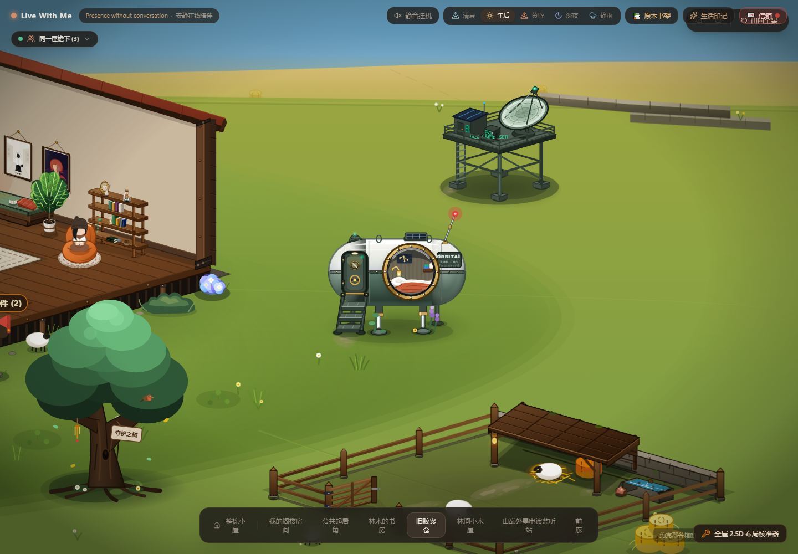
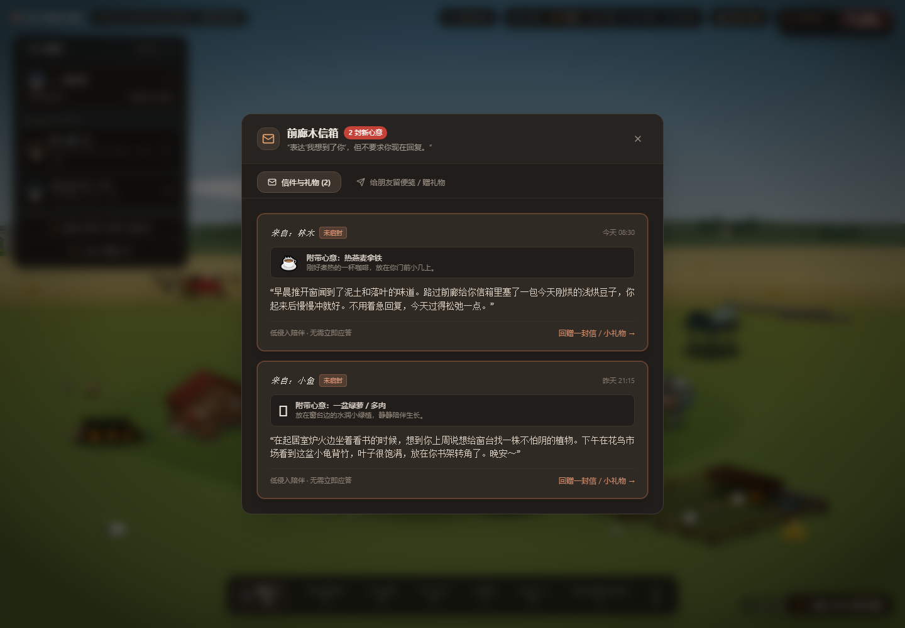

# 软投影使用合理性审计

日期：2026-10-19。范围：当前工作区的 2.5D SVG 场景与悬浮 UI。本轮仅审计，没有修改产品代码、资产、布局或已确认的人物造型。

## 结论

软投影有必要保留，但需要按用途收敛。场景需要接地感，悬浮 UI 需要与风景分离；目前的问题集中在阴影的生成方式、滤镜边界和重复叠加，不能用统一删除或统一加大模糊来解决。

当前低多边形、手绘 SVG 的清晰轮廓符合产品气质。窄接触线、桌脚小暗点和材质暗面可以保留硬边；应柔化的是离开接触区的环境遮蔽外缘。最明显的视觉问题是电波站下方的大椭圆，局部视图中更像深色底垫。

发现 **4 项问题：P0 0 项，P1 0 项，P2 3 项，P3 1 项**。没有证据说明这些阴影阻断操作或构成独立的 WCAG 违规，因此不提高严重度。本轮不提供全站可访问性、性能或响应式总分。

## 方法与证据范围

- 读取 PRODUCT.md、DESIGN.md、全局 SVG defs、代表性家具、建筑、植物、人物、蒲团和浮层组件。
- 扫描 src 下的 SVG filter、feDropShadow、feGaussianBlur、渐变接地影及 Tailwind shadow 用法。
- 使用当前源码的独立 Vite 开发预览，通过 Chromium 检查 1440×1000 的全景、阁楼、起居角、书房、胶囊舱视图；补充起居角深夜、静雨、390×844 窄屏和信箱浮层截图。冻结动画用于静态比对。
- 初始页面有 39 个节点引用全局 softShadow，排除 defs 内两处未实例化的保留资产后，场景树中为 **37 个**，其中 **17 个的局部几何高度小于 10**。这是节点数量，不是可见像素数、GPU pass 数或每帧重绘次数。
- 没有启动性能基准、帧率回归、天气光效实施或全站可访问性检查。滤镜数量只作为精简线索，不据此声称项目卡顿。

原始记录：[SVG 节点清单](metrics/SOFT-SHADOW-AUDIT-2026-10-19/inventory.json)、[UI 计算样式](metrics/SOFT-SHADOW-AUDIT-2026-10-19/ui-shadows.json)。截图均为本轮当前源码的实测画面。

## 详细发现

### S01 · P2：环境软影使用了保留硬边原图的投影滤镜

**位置**：`src/world/render/WorldDefs.tsx:59`；代表性调用为 `src/components/desk/DeskFrame.tsx:66`、`src/components/plants/MonsteraPlant.tsx:75`、`src/components/CastIronWoodStove.tsx:614`。

**证据**：softShadow 是 `feDropShadow(dx=0, dy=3, stdDeviation=3, floodOpacity=.18)`。feDropShadow 在模糊、偏移阴影之上合成 SourceGraphic，不会把原椭圆或多边形本身羽化。这些调用已经绘制了一块带透明度的暗色阴影形状，再使用 feDropShadow，相当于给阴影图形继续加一层投影。

**影响**：大面积环境软影仍保留原来的清晰椭圆／多边形边界，小物体则可能出现额外偏移暗边。代码注释中的“漫反射”“柔和”与生成方式不一致。接触影有硬边本身是合理的，问题在于它被当成了外扩软影。

**建议**：先把用途分为接触影、环境软影、实体浮雕投影。接触影保留小范围暗线／暗点；椭圆环境影优先使用末端透明的径向渐变；需要沿特定形状羽化时，单独模糊阴影形状。实体上确有层叠关系的投影可以继续使用 feDropShadow，例如舷窗外圈。

**实施边界**：不能直接把全局 softShadow 改为 feGaussianBlur，因为它也被用在衣袍、信箱立柱、枕头和被子的实体图形上。全局替换会模糊资产轮廓。

**分类／建议命令**：视觉语义、实现一致性；`$impeccable extract` 后做局部 `$impeccable polish`。不属于独立 WCAG 违规。

### S02 · P2：固定模糊与按包围盒扩展的区域不匹配

**位置**：`src/world/render/WorldDefs.tsx:59`；小尺寸代表为 `src/components/architecture/MainCottageHaven.tsx:828` 和 `src/components/CastIronWoodStove.tsx:626`。查看／校准中也有相同参数的局部定义：`src/components/desk/ChairInspectionModal.tsx:61`、`src/components/desk/DeskCalibrationWorkbench.tsx:109`。

**证据**：全局 filter 未指定 filterUnits 和 primitiveUnits，默认分别为 objectBoundingBox 和 userSpaceOnUse。`x/y=-10%`、`width/height=120%` 只在几何包围盒四边各增加 10%，但模糊标准差固定为 3 个局部单位，向下偏移也是 3。

例如茶桌后脚椭圆 `ry=1.1`，包围盒高度 2.2，底部只多出 **0.22** 个单位；约 3σ 的模糊范围加向下偏移需要约 **12** 个单位的下方空间。滤镜尾部确实被区域截断。由于尾部很淡且被缩小，这不等于每一处都能看到明显矩形切边，但输出已经受裁切影响。

**影响**：同一个滤镜对小脚印和建筑大影产生不同程度的裁切，无法稳定控制软边。为像素很少的小接触点保留该滤镜，也缺少明确视觉收益。

**建议**：优先移除微小接触点上的通用滤镜，使用紧贴触点的实色暗点或局部渐变。确需滤镜时，按模糊半径和偏移量留足区域；可使用明确的 userSpaceOnUse 区域，或依几何尺寸计算足够的包围盒余量。不要把整个世界的滤镜区域无差别放大。

**验收**：检查真实全景比例、局部放大和 390px 视口；脚底不能出现漂浮暗边，羽化尾部不能出现截断。性能收益需要后续单独测量。

**分类／建议命令**：渲染边界、尺度一致性；`$impeccable harden`，必要时后续 `$impeccable optimize`。不属于独立 WCAG 违规。

### S03 · P2：电波站的大影重复叠加，形成底垫感

**位置**：`src/components/architecture/ObservatoryHaven.tsx:74`、`src/components/scenery/yorkshire/terrain/TerrainMass.tsx:7` 与 `:179`。

**证据**：电波站自带 `rx=74, ry=22, opacity=.42` 的椭圆，以及内部 `rx=60, ry=16, opacity=.25` 的实色椭圆；另有四个脚部接触影。TerrainMass 又在同一建筑位置绘制径向渐变 AO。两块实色椭圆重叠处，仅原始形状的合成不透明度就约为 `1-(1-.42)*(1-.25)=56.5%`，还未计算地形 AO 和滤镜附加影。

**影响**：在胶囊舱局部视角中，电波站下方的大椭圆边界很清楚，容易被识别为平台底下的一块深色底垫。大面积暗块抢在细脚接地之前表达重量，让高架平台显得更沉。

**建议**：保留四处支脚接触影；建筑环境软影明确由一个层级负责。优先评估复用 TerrainMass 的渐变 AO，收掉重复的大实色椭圆，或只留一层与平台覆盖范围匹配的软影。胶囊舱也有地形 AO 与自身落影，建议随后核对，但其本体大影透明度只有 .18，本轮不作同等严重度判断。

**分类／建议命令**：视觉层级、重复遮蔽；`$impeccable quieter`。不属于独立 WCAG 违规。

### S04 · P3：普通悬浮控件与模态窗口使用相同的大软影

**位置**：`src/components/AtmosphereBar.tsx:265`、`src/components/layout-gizmo/LayoutInspectorPanel.tsx:147`、`src/components/MailboxModal.tsx:86` 和 `:166`；PresencePanel 也使用 shadow-xl。

**证据**：浏览器计算样式确认，底部房间导航、布局校准入口和信箱窗口均使用 `0 25px 50px -12px rgba(0,0,0,.25)`。这些表面还已有底色、边框和不同程度的背景模糊；信箱内部未读信件又叠加边框、ring 和 shadow-lg。

**影响**：不同高度的 UI 缺少明确的阴影级差，低矮导航也有较宽的暗晕。信箱内部的状态已由底色、边框和“未启封”标签表达，阴影增加的信息较少。实测仍可清楚辨识窗口和内容，属于收敛项。

**建议**：定义普通控件、弹出面板、模态窗口的语义层级。普通悬浮条先试用更紧凑的阴影；模态窗口保留必要层级。未读信件优先依靠现有底色、边框及标签表达状态，可去掉其装饰性外投影。场景背景复杂，边框有辨识作用，不应机械地同时移除边框与阴影。

**分类／建议命令**：UI 层级、主题一致性；`$impeccable extract`、`$impeccable quieter`。本轮没有据此认定对比度或键盘焦点违规。

## 建议保留的做法

| 用途 | 当前判断 | 后续原则 |
|---|---|---|
| 人物站姿／侧坐的渐变接地影 | 合理 | 保留与袍摆匹配的软影、窄接触线；不改已确认轮廓 |
| 蒲团底部 | 合理 | 沿用径向渐变＋贴地薄接触带 |
| 桌脚、架脚、建筑支脚的小暗点 | 合理 | 只表达接触，允许较清晰边缘 |
| 书架暗面、木板厚度、衣褶 | 合理 | 属于材质塑形，不能批量当投影清理 |
| 建筑基底渐变 AO | 方向合理 | 与建筑自带大影明确分工，避免重复 |
| 舷窗等实体叠层投影 | 有明确用途 | 可保留 feDropShadow，核对接收面与范围 |
| 云雾、草台融合的 blur／mask | 不归本轮投影整改 | 属于空气透视／地形边缘融合 |
| 夜空星点与炉火暖光 | 不按暗影处理 | 属于发光／照明，不能合并进阴影规范 |

参考实现：`src/components/characters/StandingCharacter.tsx:31`、`src/components/characters/SeatedSideBody.tsx:26`、`src/components/tea/TeaCushion.tsx:26`。这些代码可借鉴“软影与接触分离”的方法，不代表需要修改已定稿人物。

## 建议实施顺序与验收

1. **P2，`$impeccable quieter`**：先只处理电波站重复大影，以一处可见改善验证方向。
2. **P2，`$impeccable extract`／`$impeccable harden`**：分离接触影、环境软影、实体投影；选植物底影和茶桌脚影作为小范围试点，再迁移其它适合的调用。避免直接替换全局滤镜。
3. **P3，`$impeccable quieter`**：收紧普通浮层阴影，减少信箱内部的重复装饰。
4. **`$impeccable polish`**：复核全景／局部、午后／深夜／静雨、桌面／390px。确认实体轮廓依旧清晰、接触处没有浮起、软边不裁切、UI 层级可辨。之后按同一范围重跑审计。

每一步都可以独立实施，亦可合并处理；本报告不表示已启动修改。夜间／静雨截图只用于核对现有阴影，不把已延后的天气光照系统纳入本轮整改，也不以静态截图推断动画性能。
