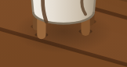
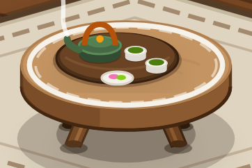

# 接地阴影分离：龟背竹与茶桌脚影试点

2026-10-19。落实软投影审计 S01／S02 的首批小范围整改。实现完成，视觉效果待用户验收。

## 实施内容

- 新增 ContactGroundShadow、AmbientGroundShadow 两个共用 SVG 组件。接触影使用紧贴触点的实色几何；环境影使用末端透明的局部渐变。两者均不使用 filter，也不参与指针命中或辅助技术朗读。
- 龟背竹保留原底影范围，改成渐变；补四个与现有花架脚末端一致的小接触影。植物实体绘制及摆放不变。
- 四个茶桌脚影保留原中心、半径、颜色及浓度，去掉通用 softShadow 引用。茶桌两块整体环境影保持原实现，因此整桌观感变化很小，脚部边缘更直接。
- 这批共移除 5 处通用滤镜引用。全局 softShadow 定义和其它调用不改，不据此声称帧率改善。

用途划分、接口和后续迁移规则见 [场景阴影规范](../../GROUND_SHADOWS.md)。实体投影沿用已有实现，没有新建未使用的封装。

## 同倍率局部对照

由同一工作区修改前后源码分别采集，Chromium、1440×1000、DPR 2、午后、相机 2.5 倍，冻结 CSS／SVG 动画。截图按同一资产局部矩形截取，没有修改图片内容。

| 龟背竹底部：修改前 | 修改后 |
|---|---|
|  |  |

| 茶桌脚影：修改前 | 修改后 |
|---|---|
|  |  |

## 验证结果

- `npm run lint`：通过。
- `npm run build`：通过。Vite 仍提示主包大于 500kB，本批没有做包拆分或性能基准。
- `git diff --check`：通过。
- 浏览器核对桌面全景／起居角、相机 .45 与 2.5 倍、390×844 窄屏、午后／深夜／静雨。
- 结构比对：植物与茶桌非试点图形、局部摆放、全局滤镜定义和其它 softShadow 调用一致。
- 试点场景包含 1 处环境渐变与 8 个接触影。植物点击反馈、键盘激活、布局校准选取均可用；pageerror 为 0。
- 3 个植物实例同时渲染，其中两个放在 SvgDetailView 中；初次挂载及重建后均无重复 ID、失效渐变引用或试点滤镜。见 [ID 验证结果](id-check.json)。

补充截图：[植物局部](after-plant.png)、[窄屏](after-mobile.png)。原始完整截图、结构快照和验证脚本保留在忽略目录 `test-results/ground-shadow-pilot`。没有新增正式测试用例，也没有迁移其它资产。
