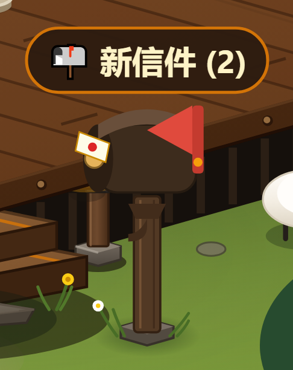
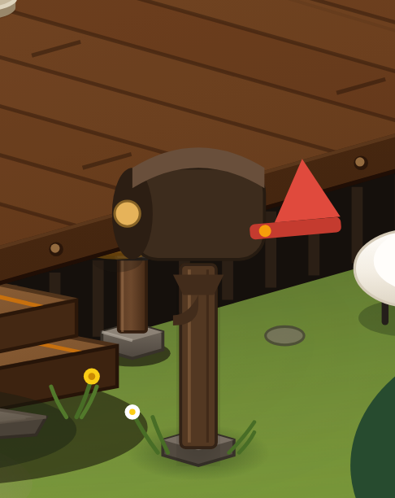
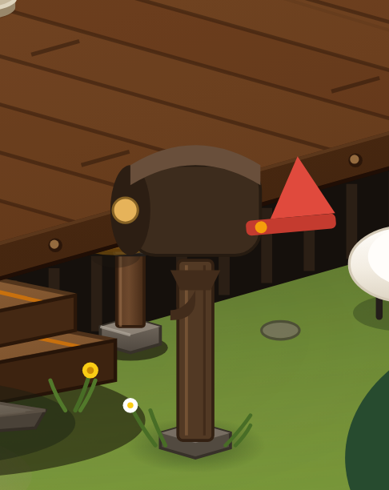

# 邮箱本体软投影试去

2026-10-19。用户回忆并确认此前存在保留人物袍子／信箱软投影的约束，本次另行授权“去掉邮箱本身的软投影看看效果”，人物袍子的继续保留。当前是待视觉验收的试去效果。

旧约束确见于 SCENE_PERFORMANCE_DIAGNOSIS.md 的检查范围，以及 CODEX_HANDOFF_2026-10-14.md 的资产保留说明。本次遵照用户最新指令，只改变邮箱指定部分，不扩大到人物或其它实体投影。

## 具体改变

在 MainCottageHaven.tsx 中移除2处 `filter="url(#softShadow)"`：木立柱与有未读信时出现的“新信件”木牌。圆拱箱体本身没有使用该滤镜。箱体的深浅色面属于原绘制，仍然保留；邮箱脚下的渐变接地影也继续保留。

| 有未读信：修改前 | 去掉本体投影后 |
|---|---|
|  |  |

| 无未读信：修改前 | 去掉本体投影后 |
|---|---|
|  |  |

截图为同一视角、Chromium 1440×1000、DPR2、相机2.5倍；冻结动画，按同一邮箱局部矩形截图。原投影较淡，效果差异主要在立柱和提示木牌的边缘，不会让邮箱变成无阴影的平面图形。

## 验证

- `npm run lint`、目标文件 `git diff --check`：通过。
- 排除指定2个 filter 属性后，邮箱完整子树哈希一致；接地影、人物袍子子树和全局 softShadow 定义哈希一致。
- 邮箱内部 softShadow 引用为0；场景人物袍子仍保留原来1处引用。
- 有信／无未读信两种状态、全景和390×844窄屏核对；键盘打开信箱、标记已读和关闭正常，pageerror为0。没有执行投递操作，没有启动性能基准。
- [修改前记录](before.json)、[修改后记录](after.json)。临时采样脚本与完整截图保留在 test-results/mailbox-shadow-off。

本次不自动提交，不将试去视为用户已认可。最新授权已补入性能诊断中的保留约束说明。
