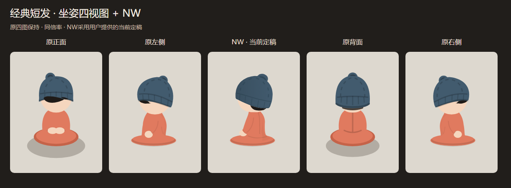

# 经典短发 NW 收腿坐姿：用户提供版本当前定稿

2026-10-16。用户明确：「**那就暂时以我这版定稿**」。认可范围为用户提供SVG所表达的经典短发、NW斜侧、独立收腿坐姿，作为当前基准；不扩大到其它三发型或椅坐适配。

## 已实施

- 原样保存 [用户原始SVG](user-original.svg)，与[确认原话及来源哈希](user-approval.json)绑定。原始文件中的历史试稿标签保持原样，仅归档元数据记录当前确认状态。
- 身体原生路径直接提取为 `approvedNwFloorSeatedAssets.ts`，`NwFloorSeatedCharacter` 读取这些路径，不重新描摹、不继续改轮廓。仅隔离SVG引用ID、把固定衣／肤色映射到同值默认配色，并移除文档全局平移；原始统一缩放比例保留。
- 定稿NW头部继续复用原组件。原四图、NW站姿、原椅、布局及旧失败椅坐稿保持。
- 现有独立SVG、四图＋NW总表和放大页切换为用户版本；人物查看／复制／下载入口改为「当前定稿」，不再指向v2的轮廓或称待审阅。
- 输出快照为 [当前定稿SVG](character-shorthair-seated-nw.svg)，与原稿分别保存[SHA256清单](manifest.json)。覆盖前v2源／资产保存于 [before](before/)，历史v1／v2证据不覆盖。

## 技术验证

- [原稿几何对比](preserved-elements.json)：全部路径命令／数值、椭圆尺寸、头部变换和原始统一缩放均一致。比较只归一化数字格式，不用近似新轮廓替代。
- [66项保护文件](protection.json)保持。Windows无头Chromium、DPR1，1340×1040与390×844验证SVG引用唯一、渐变引用有效、无位图／脚本节点及窄屏无横向溢出；390为模拟，未测真实手机。
- 本轮 `npm run lint` 类型检查及独立 `build/nw-floor-seated-approved` 生产构建通过；保留既有主包体积提示，本批无性能采样。
- 4178已更新：资源先于入口，覆盖前文件独立备份，见 [发布记录](publish.json)。独立SVG／总表／放大页的HTTP内容与生成文件逐字节一致；未停止3000或其它预览，不改用户布局／装扮存储。
- 内置浏览器刷新后实际打开「人物5视图SVG → 经典短发 → 坐姿四视图＋NW」，确认当前定稿文字与5张单图／总表全部加载，窗口无横向溢出。未把历史测试次数记为本轮结果。

## 用户最终视觉验收与范围

**用户视觉确认通过，按「暂时定稿」作为当前独立NW收腿基准。** 该确认来自上述用户原话；技术检查不替代视觉确认。

本批只完成定稿及入口同步，尚未将该稿接入温莎椅／实际房间。旧椅坐v3／v4／v5／v6均未通过；后续若继续椅坐小批，须单独核对原椅方向、坐面承托和遮挡，不能通过压扁／拉长已确认身体来套入椅子。其它发型／布局／屋顶／天气不启动，性能仍暂停，未提交／推送。

