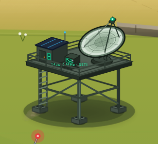
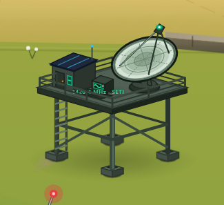

# 电波站重复大影收敛

2026-10-19，落实软投影审计 S03。只修改 `src/components/architecture/ObservatoryHaven.tsx` 的接地阴影部分。

移除电波站自身的两块大实色椭圆：`rx=74/ry=22/opacity=.42` 和 `rx=60/ry=16/opacity=.25`。整体环境遮蔽继续由 TerrainMass 的渐变 AO 承担；四处支脚接触影以及石砌脚座内部的小阴影保持原样。平台、设备、局部坐标和建筑摆放均未调整。

## 同视角对照

截图均来自本轮同一工作区和相同取景，不以此前审计截图替代本轮修改前基准。冻结 CSS 与 SVG 动画，使用 Chromium、1440×1000、deviceScaleFactor=1、午后、电波站局部视角；按同一建筑局部区域截取。

| 修改前 | 修改后 |
|---|---|
|  |  |

大椭圆的清晰边界已消失，支脚仍有贴地暗点，平台下方留有淡渐变遮蔽。2026-10-19 用户明确验收通过；确认范围为本轮电波站重复大影收敛，不扩大到其它软投影整改。

## 验证

- `npm run lint`（tsc --noEmit）：通过。
- `git diff --check -- src/components/architecture/ObservatoryHaven.tsx`：通过。
- 浏览器核对：桌面全景／电波站局部、午后／深夜／静雨、390×844 窄屏。
- 修改后 `observatory-ground-shadows` 中为四个接触椭圆；与修改前相比，地形 AO、建筑 transform、完整石砌脚座子树一致。见 [修改前结构](before-structure.json) 和 [修改后结构](after-structure.json)。
- 点击接收设备后能显示信号信息卡；捕获的浏览器 pageerror 为 0。
- 未新增测试用例，未启动性能基准或其它软投影整改。

[窄屏截图](after-mobile.png)。完整本轮截图保留在忽略目录 `test-results/observatory-shadow-quieter`。可在仓库根目录运行 `node docs/architecture/metrics/OBSERVATORY-SHADOW-QUIETER-2026-10-19/capture.mjs before|after` 重采样；需要先启动 3011 本地开发服务，且 before 必须在修改前源码状态采集。
