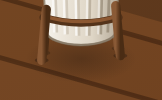
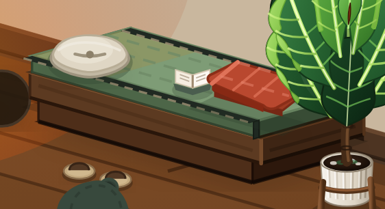
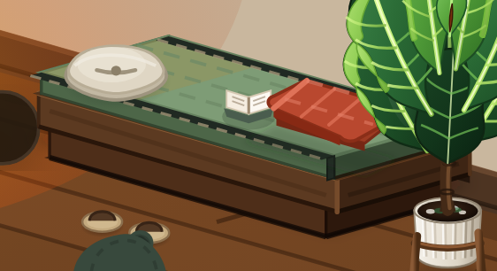

# 第2步续迁：材质表达与剩余调用判断

2026-10-19。用户要求继续复查琴叶榕及剩余调用，分别判断保留、迁移和单独调整。本轮直接迁移部分已实现并完成技术验证，视觉效果待用户验收。剩余实体投影没有宣称修复完成；本记录不代替第4步的整轮复核。

## 对材质分层观点的采用方式

采用“清晰接触影、柔和接触影、环境遮蔽影”三种基础表达，另保留实体投影这一用途。按接触关系、接收面、光源大小与距离决定边缘，再用材质调整范围和浓度。

木／金属／石制脚座通常适合小而清晰的触点；布料、软垫通常适合窄软边；宽范围遮蔽适合渐变或形状羽化。但人物贴地可以有清晰接触边，木桌下方也可以有宽软影。树冠落影有时还需表达光照方向。因此不将某种材质固定绑定某个滤镜，也不将“漫反射”作为阴影类型的物理名称。

## 剩余调用的逐项判断

下表覆盖本轮开始时所有剩余 softShadow 调用组；数值为正常场景节点数，未实例化资产和预览另列。

| 对象／调用组 | 数量 | 判断与本轮结果 |
|---|---:|---|
| 琴叶榕底影 | 1 | **迁移完成**：环境渐变＋4处花架脚接触；原 0.74 倍缩放、脚位、盆体和叶冠保留 |
| 暖炉腹下与4个炉脚 | 5 | **迁移完成**：环境软影与清晰接触点分开；炉火照明层保持 |
| 烟管墙面独立矩形影 | 1 | **单独羽化完成**：保留矩形几何，局部 blur=.8；不模糊烟管实体 |
| 墙上香草束挂钩影 | 1 | **迁移完成**：局部柔和贴墙遮蔽，保留位置 |
| 休闲榻底座的两块影 | 2 | **迁移完成**：外层保留原多边形并羽化；内层作为底座紧接触，保留原色与浓度、去掉附加投影 |
| 榻上枕头底影 | 1 | **迁移完成**：柔和接触渐变，枕头实体不动 |
| 折毯下独立多边形影 | 1 | **单独羽化完成**：保留席面上的轴测形状，blur=.65 |
| 榻前两只拖鞋底影 | 2 | **迁移完成**：柔和接触渐变，拖鞋实体不动 |
| 起居角大地毯底影 | 1 | **单独羽化完成**：保留轴测轮廓，blur=.6，避免额外偏移暗边 |
| 茶桌下两块整体椭圆 | 2 | **收敛完成**：合成一层渐变环境影；此前已处理的4个脚影保留 |
| 茶盘与桌面接触 | 1 | **迁移完成**：保留原椭圆的接触几何，去掉附加投影 |
| 懒人沙发地毯底影 | 1 | **迁移完成**：柔和接触；范围按实际地毯外缘略展开，避免新影完全被地毯遮住 |
| 信箱草地底影 | 1 | **迁移完成**：原范围改为环境渐变，石础与立柱实体不动 |
| 原木书桌地面多边形影 | 1 | **单独羽化完成**：保留几何，blur=1.2；脚底小暗点保留 |
| 两个笔记本与桌面的影 | 2 | **单独羽化完成**：保留几何，blur=.5；不处理电脑本体 |
| 胶囊舱整体草地影 | 1 | **删除重复层完成**：复用 TerrainMass 的建筑 AO，保留各支脚接触影 |
| 暖炉悬浮色卡的实体矩形 | 1 | **单独调整，尚未实施**：这是牌面投影，不是地面阴影；需独立检查显示状态与边界 |
| 懒人沙发人物的袍摆实体 | 1 | **单独调整，尚未实施**：滤镜作用于衣袍本体，不能替换为地面影；保留既有造型，后续单独核对 |
| 信箱立柱与新信件木牌实体 | 2 | **单独调整，尚未实施**：分别核对投影接收面和边界，不能合并成草地影 |
| 胶囊舱舷窗圈、枕头本体、被子本体 | 3 | **单独调整，尚未实施**：保留清晰实体轮廓及叠层关系，另定各自投影参数与范围 |

本轮前正常场景共有31处旧滤镜调用，其中24处影形引用已迁移或收敛，剩余7处为上表明确列出的实体图形投影。不是把旧滤镜归零，也没有把这7处判定为正常。

## 保留项与预览资产

- **保留**：已验收电波站的地形渐变 AO 与脚部触点；已确认人物、蒲团的渐变和薄接触带；家具的材质暗面、木板厚度与脚部小暗点。
- **保留**：云雾、地形融合遮罩、炉火暖光与星点。这些不是本轮要迁移的暗影。
- **预览迁移完成**：原温莎椅的底影改用环境渐变；桌面校准草稿使用与场景一致的多边形羽化。删除了两处已无人引用的预览 softShadow 定义，人物绘制源不改。
- **未实例化保留资产**：WorldDefs 中石材壁炉与野餐场景还有2处引用，属于明确保留的资产，未计入上述7处，当前不影响场景输出。cozyShadow 无引用，本轮不做清理。
- **独立造型待评估**：树冠已有渐变与斑驳光斑，但其内部实色暗区，以及猫狗软窝的层叠椭圆，属于特定造型／受光表达。没有套用统一材质规则修改，也没有据此认定它们均有缺陷；后续如调整应各自提供对照。

## 同倍率对照

Chromium，1440×1000，DPR 2，午后，相机2.5倍；冻结 CSS／SVG 动画，按同一资产局部矩形截图。没有修改图片内容。

| 琴叶榕：修改前 | 修改后 |
|---|---|
|  |  |

| 茶桌：修改前 | 修改后 |
|---|---|
|  |  |

| 休闲榻与枕毯：修改前 | 修改后 |
|---|---|
|  |  |

[迁移后的全景](after-overview.png)、[390px 窄屏](after-mobile.png)。完整各房间、昼夜与静雨截图保留在忽略目录 test-results/shadow-migration。

## 验证

- `npm run lint`、`npm run build`、`git diff --check`：通过。构建有主包超过500kB的提示，本轮没有做性能基准或包拆分。
- 3505个非迁移 SVG 图形的序列化结果在正规化 React 生成ID后哈希一致，已采集的家具摆放、琴叶榕内部缩放和全局 softShadow 定义一致。排除项只包含迁移的影形及既有语义阴影。
- 本轮4个房间局部、全景、午后／深夜／静雨和390×844窄屏静态核对完成。琴叶榕点击、键盘激活及布局校准选取正常；pageerror 为0。
- 新多边形／矩形羽化滤镜使用 userSpaceOnUse，四边余量为 ceil(3σ)+1 个局部单位。独立双预览首次挂载、重建，以及真实工位原椅对比／桌椅关系／校准草稿，共5次检查通过：新引用不失效，羽化区域包含几何外至少3σ。
- 独立双预览无重复ID；不据此宣称全项目旧资产ID已全部清理。人物造型未重新验收，整轮 polish／重审计仍待后续。

证据：[修改前结构摘要](before.json)、[修改后结构摘要](after.json)、[预览及边界检查](preview-check.json)。验证使用忽略目录中的临时脚本，未新增正式测试用例。全局滤镜保持原定义，代码没有批量替换实体图形上的投影。
