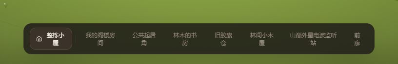
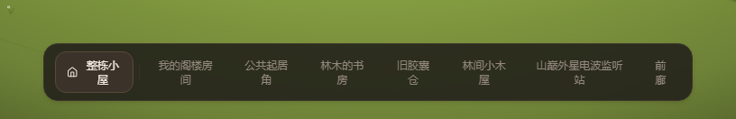
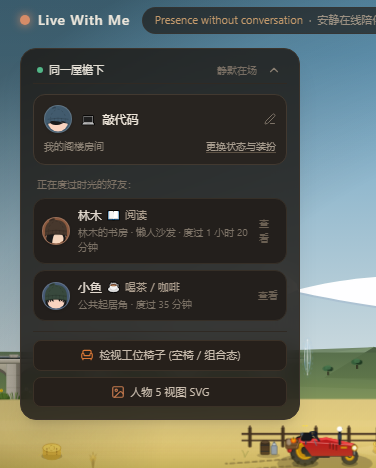
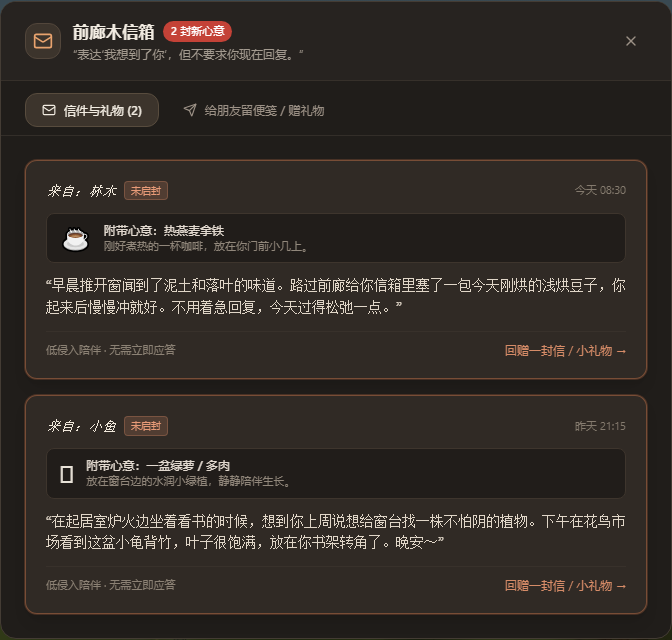
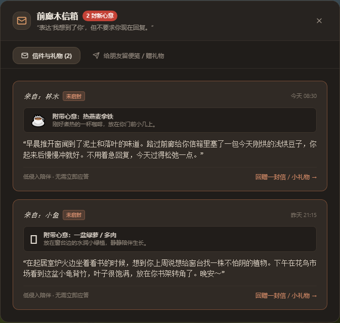

# 普通浮层阴影与信箱装饰收敛

2026-10-19。落实软投影审计 S04。实现与技术验证完成，视觉效果待用户验收。

## 实施

在 src/index.css 增加两个语义阴影值，供 Tailwind 生成对应工具类：

| 层级 | 工具类 | 阴影 |
|---|---|---|
| 普通悬浮控件 | shadow-overlay-control | `0 2px 6px -2px rgb(0 0 0 / .2)` |
| 展开面板／提示面板 | shadow-overlay-panel | `0 3px 8px -2px rgb(0 0 0 / .24)` |

普通层级应用于底部房间导航、同住人折叠入口、布局校准入口、场景缩放栏与悬停提示。展开层级应用于同住人面板、布局校准面板、声音混音台、设计初心面板和 toast。条件显示的提示使用同一套值；本轮没有新增触发行为。

信箱未读卡片移除 shadow-lg 与额外的 ring 装饰，保留原有底色、1px 边框、“未启封”标签、未读数量和读后状态。信箱外窗继续使用原模态窗口阴影，遮罩和背景模糊保持原样。

没有修改文字配色、窗口尺寸、按钮布局、动画、焦点样式或业务逻辑。其它模态窗口和具有信号语义的特殊发光提示保持原实现。场景 SVG 阴影不在这批改动范围。

## 前后对照

截图来自同一工作区本批修改前后，Chromium，1440×1000，DPR 1，午后，冻结 CSS／SVG 动画。

| 导航条：修改前 | 修改后 |
|---|---|
|  |  |

| 同住人面板：修改前 | 修改后 |
|---|---|
|  |  |

| 信箱：修改前 | 修改后 |
|---|---|
|  |  |

## 验证

- `npm run lint`：通过。
- `npm run build`：通过；生成 CSS 包含两个新工具类和对应语义值。Vite 提示主包超过 500kB，本批没有进行包拆分或性能基准。
- `git diff --check`：通过。
- 计算样式核对导航、同住人展开／收起、布局校准入口／面板、场景缩放栏、混音台和信箱外窗。除阴影外，采集到的尺寸、文字、边框、底色与背景模糊保持一致。
- 两张初始未读卡片的 box-shadow 均为 none，底色、边框和文字保持一致。信箱外窗阴影与修改前完全一致。
- 房间切换、面板开合、声音混音台、键盘打开信箱、点击信件更新未读状态、关闭后保留草稿、390×844 窄屏关闭按钮可达，均通过。没有执行投递操作。
- 浏览器 pageerror 为 0。没有新增正式测试用例，没有声称完成全站可访问性审核。

计算样式及操作记录：[修改前](before.json)、[修改后](after.json)。窄屏见 [信箱截图](after-mobile-mailbox.png)。完整截图保留在忽略目录 test-results/ui-shadow-quieter。

可在仓库根目录运行 `node docs/architecture/metrics/UI-SHADOW-QUIETER-2026-10-19/capture.mjs before|after` 复采；需要 3011 本地开发服务，before 必须在本批修改前源码状态运行。脚本只切换本地界面、读信和编辑未投递草稿。
