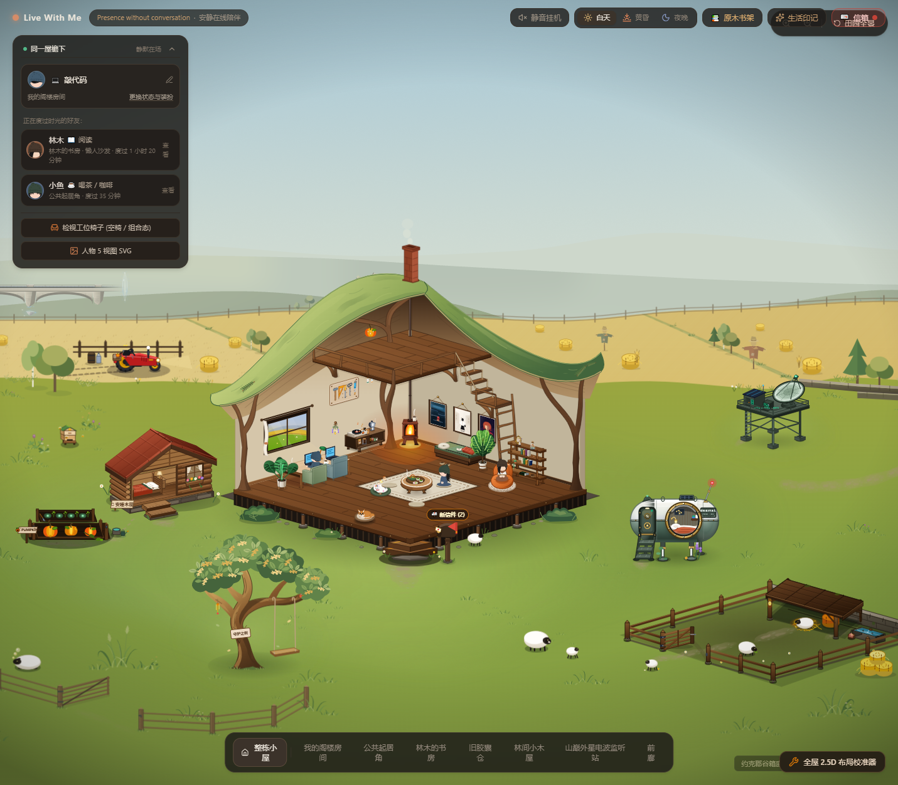
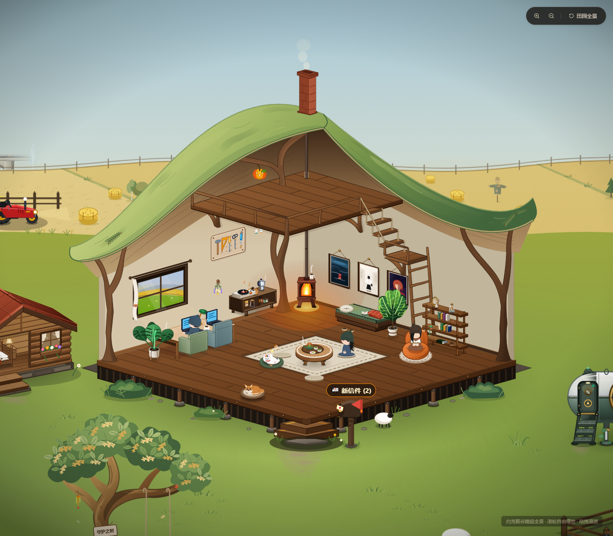
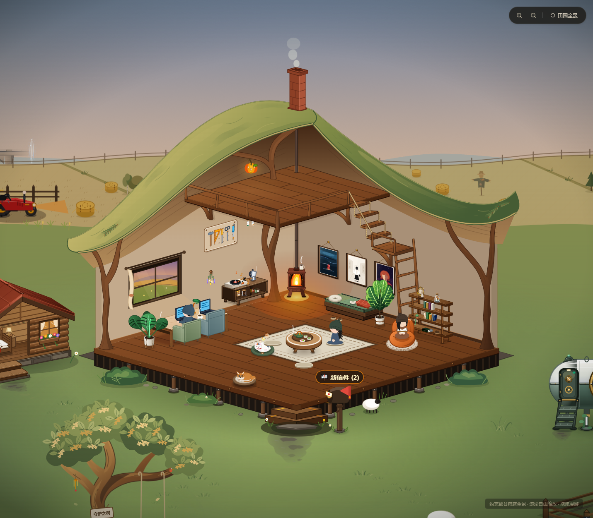
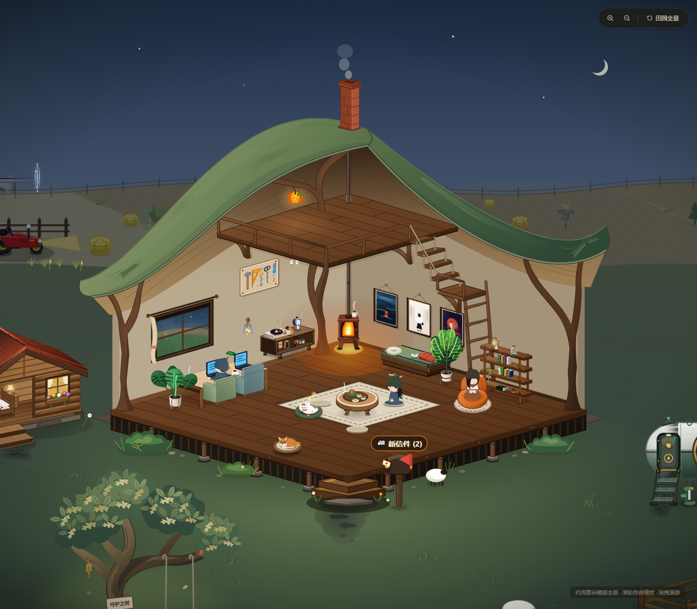

# F2 默认木屋定稿

2026-10-30，用户明确确认“当前效果可以作为 F2 的默认场景”。

当前定稿为大小不对称种荚屋顶、自然枝撑、阁楼与连廊、五档直梯、四级绳连踏步、原陶砖色烟囱，以及与原地板共用材质规则的浅暖棕阁楼地板。保留阁楼南瓜灯、书桌台灯和窗景的昼暮夜变化；夜间墙板采用已回调的温润暖色。中柱、右柱新增的两盏吊灯及其光效已删除。

`CURRENT_F2_SCENE.cottage = 'seedpod'` 明确记录默认建筑，主屋通过统一场景配置读取。无参数首页和 fixture 均直接启用当前效果；`?cottage=classic` 仅用于旧屋显式对照。

## 验证

- TypeScript 检查与生产构建通过，构建仍有已有大包提示。
- 默认场景配置、显式对照、房间取景与探索边界共 5 项定向单元检查通过。
- 无参数首页、昼暮夜近景、旧屋显式对照共 5 个实际页面检查通过；F2 均启用，页面运行错误为零。
- 首页与三个时段近景均包含种荚屋顶、阁楼、直梯、南瓜灯，均不含已删除的两盏一楼吊灯；窗景与书桌台灯时段正确。
- 截图与实际运行状态见本目录及 `capture-report.json`。复现：`node scripts/capture-f2-cottage-default.mjs`。

原生 SVG 插画剖视及现有交互继续沿用。雨雪遮罩、积雪和阁楼人物席位不包含在本次定稿中。
