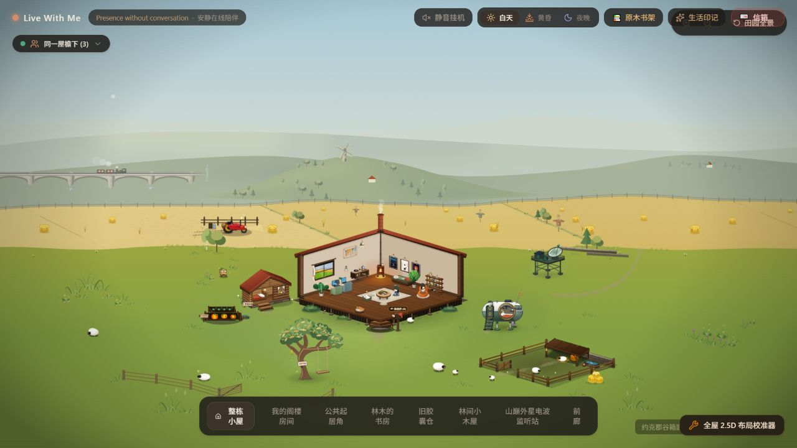

# 已审核丘陵纳入 F2 默认场景 · 2026-10-29

用户批准后，基于 `29e2eab` 将当前混色草甸丘陵纳入 `codex/f2-hills-integration` 的默认场景。

现在直接打开 <http://127.0.0.1:3012/> 即可看到审核版，无需实验参数。统一配置 `CURRENT_F2_SCENE.foothillForm` 为 `meadow`。

## 纳入的版本

- 连续自然轮廓的单座草甸主丘，带风车与农舍。
- 草甸 / 偏干草 / 林下植被连续混色，白桦 / 暖阔叶树 / 青松分种配色。
- 现有主丘 22 棵树及东侧 9 棵树，共 31 棵。
- 已修复竖向采样条纹的 360 列材质。
- 已有白天 / 黄昏 / 夜晚响应；未包含尚未迁移的四季雨雪。

默认场景不包含旧闭合色块或后方小丘。审核状态由 experimental 改为 accepted。原慢速远山响应、农田 / 草地 / 铁路独立运动沿用。

## 对照入口

原审核链接继续有效，显示与默认相同的内容：

<http://127.0.0.1:3012/?foothillStudy=gentle-hill&foothillComposition=windmill&foothillContour=natural&foothillSurface=meadow&foothillCover=blended>

2026-10-29 清理后，失败试样代码和旧实验参数分支已移除；上面的已保存链接仍会显示当前定稿。旧远山坡脚可通过 <http://127.0.0.1:3012/?foothillForm=source-foot> 对照；`hills=legacy` 和 `hillsTransition=off` 仍有效。

## 验证

- 类型检查、全部 75 项单元测试及生产构建通过，保留既有大包体警告。
- 浏览器实测无参数入口：meadow-hill、blended-vegetation、accepted、360 列、31 棵树、一个风车，无后丘及旧色块，见 `default-check.json`。
- 默认与原审核链接的轮廓路径、全部渐变停靠点颜色、树木根点 / 形状色、农舍、风车数据逐项相同，见 `reviewed-parity.json`。
- 同镜头昼暮夜已检视，见本目录截图；独立拖动前后投影见 `motion-check.json`。
- 原坡脚入口仍为 source-foot、25 棵树、0 座丘陵，见 `source-foot-check.json`。
- 相关浏览器测试断言同步更新；本轮浏览器核对使用应用内浏览器，未运行完整 Playwright 浏览器测试套件。

清理后的验证：64 项有效单元测试、类型检查和生产构建通过；三个时段全部材质采样及浏览器中的轮廓 / 色阶 / 树木 / 农舍 / 风车数据与清理前一致，见 [清理记录](../F2_CLEANUP_2026-10-29.md) 和 `cleanup-verification.json`。原 75 项包含已删除失败试样的 11 项检查。

